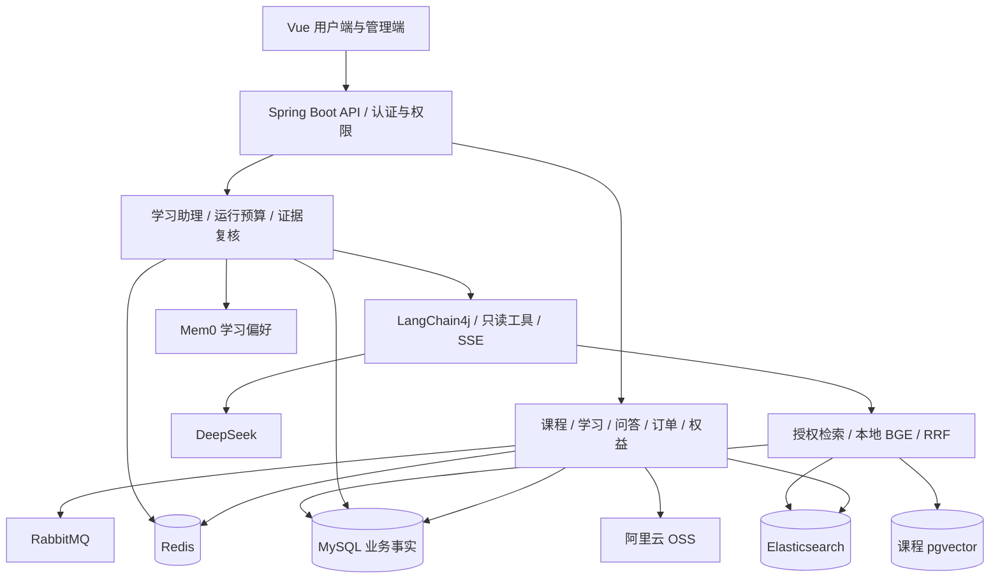

# 问课尚学（LearnHub）

面向职业学习者的在线教育平台，覆盖课程发现、视频学习、互动问答、学习权益与课程学习助理。项目采用前后端分离的模块化单体架构，既实现学习业务，也实践异步一致性、搜索投影和受权限约束的 Agent 应用。

学习助理基于 LangChain4j 接入流式对话、课程资料检索、只读工具与学习偏好记忆。MySQL 保存业务事实和正式聊天历史，Elasticsearch 与 pgvector 保存可重建的检索投影。

## 功能概览

| 模块 | 当前能力 |
| --- | --- |
| 课程与学习 | 分类、标签、关键词搜索、课程详情、章节课时、试看与购买权限、视频播放、播放进度与完成状态、收藏与点赞 |
| 互动问答 | 发布问题与回答、关联课程、问题详情、分页、赞同与取消赞同、用户互动状态 |
| 学习权益 | 普通优惠券、限量秒杀券、活动与库存校验、领取状态查询、个人优惠券 |
| 订单 | 创建订单、使用优惠券、取消与超时关闭、本地演示支付与退款、购买权限联动 |
| 学习助理 | 独立聊天工作区、会话管理、MySQL 历史、SSE 流式输出、取消、来源展示、课程只读工具与偏好管理 |
| 管理后台 | 课程分页与编辑、草稿/发布/下架、章节课时维护、封面和视频上传、分类标签维护、优惠券活动创建 |
| 认证与媒体 | 注册登录、刷新与撤销令牌、修改密码、管理员鉴权；OSS 上传、预签名直传、上传确认、临时访问及资产删除 |

**支付边界：**目前的 `LOCAL_DEMO` 模式用于验证订单和权益状态变化，没有接入第三方支付渠道、真实资金退款或支付渠道对账。

## 技术栈与架构

| 层次 | 技术与职责 |
| --- | --- |
| 前端 | Vue 3、TypeScript、Vite 6、Pinia、Element Plus |
| 后端 | Java 17、Spring Boot 3.3.5、Spring Security、MyBatis-Plus、Maven 多模块 |
| 业务存储 | MySQL 8.4；保存用户、课程、订单、权限、资料、聊天及偏好元数据 |
| 缓存与消息 | Redis 7.4、Redisson、RabbitMQ 4；原子操作、幂等、异步聚合、重试与补偿 |
| 搜索与向量 | Elasticsearch 8.15.3、中文 IK 分词；本地 BGE 中文 Embedding、PostgreSQL 16 / pgvector、RRF 融合 |
| Agent 与记忆 | LangChain4j 1.22.0 普通 Java 模块、DeepSeek、ChatMemory、自部署 Mem0 学习偏好服务 |
| 媒体与工程支撑 | 阿里云 OSS、Docker Compose、Springdoc OpenAPI、Actuator、JUnit 与 HTTP Mock |



课程向量库与 Mem0 使用独立数据库和运行账号。Mem0 用于学习偏好召回，不承担课程事实检索或授权判断。

## 关键实现

### 秒杀与点赞的异步一致性

- 秒杀通过 Redis Lua 原子校验活动、库存和重复领取，并预扣库存；RabbitMQ 异步确认，MySQL 条件更新、唯一约束和消费记录共同处理重复请求。发布确认、重试、死信与补偿对账覆盖失败分支。
- 点赞通过 Redis Set 保证用户维度幂等，消息进入持久化 inbox 后批量更新关系和计数。事件去重、关系序列、批次记录与对账用于处理重投、乱序和聚合状态丢失。
- Redisson 用于必要临界区的互斥；数据最终状态依靠数据库约束、幂等消费与补偿机制共同维护。

### 可重建的搜索与检索投影

课程搜索使用 ES 原生 `bool`、`multi_match`、`function_score` 和 completion 联想，以 BM25 相关性为基础，叠加有上限的点赞热度加分。课程写入与同步任务在同一数据库事务中提交，任务支持代次校验、失败退避和重试；全量重建写入新索引后切换别名。

课程 RAG 支持授权 BM25 与本地中文 BGE 向量召回，通过 RRF 合并排序；向量不可用时回退到 BM25。课程正文、所属课时、可读权限和资料版本仍回到 MySQL 复核，索引命中本身不授予访问权限。

### 有界上下文与可撤销依赖

- MySQL 保存正式会话和消息，ChatMemory 只负责本次模型输入，淘汰上下文不会删除历史。
- 从最多 48 条近期消息中筛选完整、已完成且依赖有效的回合，按输入字节、输出预留与运行剩余额度决定选入范围。
- 较早回合可生成最多 4 条用户原话摘录，每条至多 160 个 Unicode code points；每次重建，不额外调用模型，也不把旧助手文本当作已验证事实。
- 课程材料、历史、偏好和工具观察共享证据复核边界。资料切版、撤权或偏好忘记会使相关历史退出后续上下文选入，或使正在生成的回答失效；不物理删除正式聊天历史。
- 只开放课程搜索、课程目录、资料检索与本人学习进度四类只读工具。身份来自登录上下文，工具不能任意指定用户、SQL、Shell 或 URL。
- 每轮模型调用与工具执行继续受到调用次数、输入/输出预算、限流、并发、截止时间和取消保护。字节作为 Token 上界的估算是保守预留，不是精确分词或金额计费。

**回答质量边界：**当前已经校验结构、引用编号和依赖有效性，但尚不能证明每个回答事实都被引用资料支持。非空召回、RRF 排名高或引用编号合法均不代表证据充分；真实模型的长对话、歧义澄清与拒答质量仍需独立验收。详情见[上下文工程记录](docs/ASSISTANT_CONTEXT_ENGINEERING_20261020.md)。

## 目录结构

```text
LearnHub/
├─ learnhub-common/      # 通用响应、异常与基础契约
├─ learnhub-pojo/        # 公共数据对象
├─ learnhub-server/      # API、业务服务、Agent、中间件集成及后端测试
├─ learnhub-web/         # Vue 用户端、学习助理与管理后台
├─ services/mem0/        # 自部署学习偏好服务与私网依赖
├─ sql/                  # MySQL 基线、种子、增量迁移与 PostgreSQL 结构
├─ deploy/               # 基础服务、课程向量库和记忆服务的 Compose 配置
├─ scripts/              # 隔离验收、资料导入和媒体维护脚本
├─ docs/                 # 架构、部署、实施与验收记录
├─ experiments/          # 独立兼容性实验
└─ design-system/        # 界面设计规范
```

## 本地启动

以下命令从仓库根目录执行，示例采用 PowerShell。仅重写本文不会改变现有 `.env`、数据库或运行中的服务。

### 1. 准备环境与配置

准备 JDK 17、Maven 3.9.10 和 Docker Compose v2，前端建议使用 Node.js 22。`mvn`、`java`、`node`、`npm`、`docker` 需在 PATH 中；本项目 Windows 环境也可使用 `D:\Android\apache-maven-3.9.10\bin\mvn.cmd`。

```powershell
# 已有配置时保留原文件。
if (!(Test-Path .env)) { Copy-Item .env.example .env }
```

按 [.env.example](.env.example) 填写连接参数。Java 从根目录或上级目录读取 `.env`；Docker 只使用 Compose 显式引用的变量，修改 Java 密码配置不会自动更新已有容器账号。

示例只列连接/凭据、运行开关、模型身份及成本边界。超时、重试、线程数、同步批量、摘要压力、工具投影大小等已经由 Java 配置类或 YAML 提供默认值，日常无需写入 `.env`。需要特殊调优时，再按 [application.yml](learnhub-server/src/main/resources/application.yml) / [application-vector.yml](learnhub-server/src/main/resources/application-vector.yml) 中已有变量名增加对应覆盖项；已有非默认覆盖应保留。配置职责及本次精简记录见[说明](docs/ENV_SIMPLIFICATION_20261025.md)。

新环境默认关闭 AI、OSS、课程向量与偏好记忆，可先运行基础业务。示例的 `LOCAL_DEMO` 支付不发生真实资金交易。JWT 在开发环境未配置密钥时生成临时密钥，重启后旧令牌不可继续验证；需要稳定身份时配置持久化 RSA 密钥文件，`prod` profile 强制要求配置密钥。

### 2. 启动基础中间件

```powershell
docker compose --env-file .env -p deploy -f deploy/docker-compose.yml up -d --wait mysql redis rabbitmq elasticsearch
```

- 首次空 MySQL 数据卷会自动执行 `sql/schema.sql` 和 `sql/seed.sql`。已有数据卷不会自动升级，需按对应功能说明应用 `sql/migrations/` 下适用的迁移。
- ES 默认使用 `ik_max_word` / `ik_smart`，需要安装与 ES 8.15.3 匹配的 IK 插件；基础镜像没有自带该插件。新环境暂不安装时，可在自己的 `.env` 中将 `LEARNHUB_SEARCH_ANALYZER` 和 `LEARNHUB_SEARCH_SEARCH_ANALYZER` 均设为 `standard`，中文搜索效果与 IK 不同。已建索引切换分词器后需要重建。
- 保持搜索同步开启时，后端检测到搜索别名缺失会从 MySQL 建立投影；管理端也提供 `POST /api/admin/search/courses/rebuild`，要求管理员身份。详见[搜索实现](docs/ELASTICSEARCH_SEARCH_IMPLEMENTATION.md)。
- Kibana 属于可选 `tools` profile，基础业务不依赖；上述命令不会启动它。

Compose 中的默认账号和未启用安全认证的服务配置仅适合本地开发，生产部署需另行配置凭据、网络隔离与访问控制。

### 3. 构建并启动后端

```powershell
mvn verify
java -jar learnhub-server/target/learnhub-server-0.1.0-SNAPSHOT.jar
```

后端默认端口 `8080`，可通过 `SERVER_PORT` 调整。更改 `.env` 后，在下次正常启动后端时加载；若本机已有服务，请先核对端口及配置，不并行启动占用同一端口的实例。

### 4. 启动前端

在另一个终端执行：

```powershell
Set-Location learnhub-web
npm ci
npm run dev
```

前端默认访问 [localhost:5173](http://localhost:5173)，`/api` 代理到 `localhost:8080`。修改后端端口时同步修改 [Vite 代理](learnhub-web/vite.config.ts)。前端变量示例见 [learnhub-web/.env.example](learnhub-web/.env.example)。

| 页面或入口 | 默认地址 |
| --- | --- |
| 课程 | [localhost:5173/courses](http://localhost:5173/courses) |
| 社区问答 | [localhost:5173/questions](http://localhost:5173/questions) |
| 学习权益 | [localhost:5173/coupons](http://localhost:5173/coupons) |
| 学习助理 | [localhost:5173/assistant](http://localhost:5173/assistant)，需登录并启用对应功能 |
| 管理后台 | [localhost:5173/admin](http://localhost:5173/admin)，需管理员身份 |
| 健康检查 | [localhost:8080/actuator/health](http://localhost:8080/actuator/health) |
| 接口文档 | [localhost:8080/swagger-ui.html](http://localhost:8080/swagger-ui.html)，受当前安全配置保护 |

注册普通用户不会自动取得管理员角色。课程、媒体和助理资料需在自己的环境中初始化；新建数据库不包含维护者本机的 OSS 文件、讲义回填结果或供应商凭据。

## 按需启用学习助理与媒体

| 用途 | 配置与准备 |
| --- | --- |
| 本地聊天演示 | `LEARNHUB_ASSISTANT_CHAT_ENABLED=true`、`LEARNHUB_AI_MODE=FAKE`，保持 `LEARNHUB_ASSISTANT_LANGCHAIN_ENABLED=false`；用于 UI/流式流程演示，不代表真实 RAG 回答 |
| LangChain4j 真实生成 | 启用聊天与 LangChain 开关，设置 `LEARNHUB_AI_MODE=DEEPSEEK`；在本地填写模型凭据，准备会话/资料表、授权材料和 ES 投影；真实调用会产生费用 |
| 课程向量与混合检索 | 追加 `vector` profile，配置独立 PG 账号，按需启用 `LEARNHUB_VECTOR_ENABLED`、`LEARNHUB_VECTOR_SYNC_ENABLED` 和 `LEARNHUB_VECTOR_HYBRID_ENABLED`，完成资料向量投影 |
| 学习偏好记忆 | 部署配套 Mem0 服务，启用 `LEARNHUB_ASSISTANT_MEMORY_ENABLED`；自动提取另有独立开关，额外模型调用计入统一预算 |
| OSS 媒体 | 启用 `LEARNHUB_OSS_ENABLED` 并配置自己的区域、Endpoint、Bucket 与本地凭据；通过现有资产上传/确认流程绑定封面和视频 |

向量库与 Mem0 属于选配，启动基础业务不要求部署它们。偏好记忆默认关闭自动提取，显式偏好写入使用 `infer=false`。首次 BGE 模型加载、原生库与镜像准备以部署记录为准。

具体步骤分别见[服务部署](deploy/README.md)、[课程向量安装](docs/ASSISTANT_VECTOR_INSTALLATION_20261019.md)、[Mem0 部署](services/mem0/README.md)和[讲义导入说明](docs/assistant-materials/README.md)。`course-media` 本地 Nginx 服务已经移除，当前媒体方案使用 OSS。

## 测试与验证

后端在根目录执行：

```powershell
mvn test
mvn verify
```

前端在 `learnhub-web/` 中执行：

```powershell
node --test scripts/*.test.mjs
npm run build
```

`build` 包含 Vue/TypeScript 类型检查和 Vite 生产构建。真实中间件、供应商和本地数据维护测试多数需要显式开启，默认跳过不能算作真实集成通过。

仓库提供隔离验证脚本，例如：

```powershell
pwsh -NoProfile -File scripts/auth/verify-infrastructure.ps1
pwsh -NoProfile -File scripts/commerce/verify-infrastructure.ps1
pwsh -NoProfile -File scripts/admin/verify-course-management.ps1
pwsh -NoProfile -File scripts/assistant/verify-chat.ps1
```

这些入口用于对应功能的受控验证，执行前阅读脚本参数与专题说明。`verify-live.ps1`、`verify-langchain-live.ps1` 属于真实供应商验收，不是普通单测；不要在未确认调用范围与额度时执行。

2026-10-20 上下文工程代码交付时，根 `test` 与 `verify` 各 602 项，489 实际执行、113 条件跳过，零失败/错误。前端 105 项及构建的既有记录见[系统验收](docs/ASSISTANT_FINAL_ACCEPTANCE_20261019.md)。这些是有日期和范围的验收记录，不等于当前任意环境的部署或模型质量保证。

## 数据与验收边界

- 2026-10-20 本地回填记录为 57 份有效资料、273 个片段及 273 条向量；讲义包含 AI 生成的教学补充内容，不是教师逐字稿，未逐视频审校。
- 同日完成 21 个封面、42 个视频迁移至 OSS。该结果属于既有本地环境，克隆仓库不会复制对象存储资源或数据库绑定。
- 72 题检索评测衡量来源召回和排序，不是回答正确率；资料不足题仍可能召回弱来源。新增 16 题上下文规范尚未作为完整批次运行，不能报告为独立质量验收通过。
- 摘要目前是有来源序号和依赖复核的用户原话摘录，指代处理是启发式检索规划；通用歧义澄清、独立证据充分性判断、工具观察相关性压缩与真实模型长对话质量仍待完善。
- 真实支付渠道、生产退款与清算、视频转码、直播、内容审核和个性化推荐尚未形成完整产品闭环。

## 文档导航

| 文档 | 内容 |
| --- | --- |
| [开发协作约定](AGENT.md) | 分层、Git 提交、密钥保护与验证要求 |
| [部署说明](deploy/README.md) | 基础服务、选配向量/记忆服务与持久卷 |
| [数据库说明](sql/README.md) | 结构、中文注释与迁移验证 |
| [认证运维](docs/AUTH_SECURITY_RUNBOOK.md) | JWT、刷新/撤销和密钥配置 |
| [秒杀一致性](docs/SECKILL_CONSISTENCY_RUNBOOK.md) | 消息重试、补偿与对账 |
| [课程搜索](docs/ELASTICSEARCH_SEARCH_IMPLEMENTATION.md) | 检索 DSL、索引同步与重建 |
| [管理后台](docs/ADMIN_COURSE_MANAGEMENT.md) | 发布约束、章节课时及分类标签维护 |
| [助理接手说明](docs/ASSISTANT_HANDOFF_20261020.md) | 既有能力、环境快照与交接约束 |
| [上下文工程](docs/ASSISTANT_CONTEXT_ENGINEERING_20261020.md) | 动态预算、可失效摘录、结果分类与质量缺口 |
| [向量回填验收](docs/ASSISTANT_VECTOR_LOCAL_ACCEPTANCE_20261020.md) | 全量投影、三路检索及评测边界 |
| [媒体迁移记录](docs/COURSE_MEDIA_OSS_MIGRATION_20261020.md) | OSS 上传、访问验证与旧媒体服务移除 |

文档包含分阶段设计与历史环境快照；判断当前能力时，优先核对代码、配置及日期较新的实施记录。
