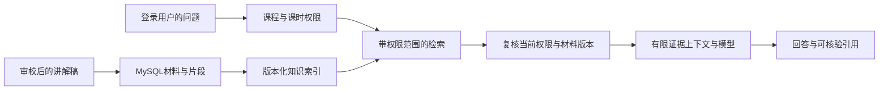

# LearnHub：Agent、RAG、MCP 学习路线与开发交接

- 编写日期：2026-10-15。
- 项目基线：`master`，`b82560e`；本文件位于 `feature/agent-learning-handoff`。
- 读者：已经通过 LearnHub 熟悉 Java Web，准备通过实际开发学习 AI 应用与 Agent 的初学者。
- 本轮范围：阅读代码、核对官方资料、提出实施建议。**以下新增模块、接口和表都是设计草案，目前没有实现。** 本轮没有安装依赖、调用模型、修改配置或业务数据。

## 1. 结论：能接，而且有合适的业务场景

建议把学习项目命名为“课程学习助理”，逐步实现三个体验：

1. **查资料**：“这节 Redis 课为什么使用 Lua？”助理检索课时讲解稿，回答并给出可点击的来源。
2. **帮我安排练习**：“结合我的 Redis 学习进度，推荐下一步练习。”助理选择调用进度、课程目录和资料检索工具，再形成建议。
3. **让外部 AI 使用平台能力**：通过 MCP，让一个支持该协议的本地客户端调用 LearnHub 的公开课程搜索与目录工具。

这些功能能分别练习知识处理、检索、模型调用、权限、工具编排和协议接入。继续使用现有模块化单体，不必为了学习 Agent 先拆微服务、引入多套向量库或重写成 Python。

本文选择的学习顺序是：**模型基础 → 知识检索 → 带引用 RAG → 有边界的只读 Agent → MCP Server → 可选的向量混合检索/MCP Client**。这是结合本仓库提出的教学路线，不是某个框架强制要求的顺序。

## 2. 先分清几个概念

| 概念 | 解决的问题 | 在 LearnHub 中的例子 |
| --- | --- | --- |
| LLM 调用 | 把消息交给模型并处理返回值 | 对一段已授权讲解稿做摘要 |
| Embedding | 把文本变成用于语义比较的向量 | 把问题与知识片段编码后做近邻检索 |
| RAG | 先取得相关资料，再让模型据此生成回答 | 回答课程问题并附片段引用 |
| Tool Calling | 模型提出结构化的工具名和参数，由程序校验、执行 | 请求调用 `get_my_learning_progress` |
| Workflow | 程序事先固定步骤 | 每次都执行“鉴权→检索→回答” |
| Agent | 模型在受控循环中选择下一步工具或结束回答 | 判断先查目录还是先查进度，再决定是否补查材料 |
| MCP | 用统一协议提供、发现和调用工具、资源等能力 | 把平台课程查询提供给兼容客户端 |

一个检索问答功能可以使用固定 workflow，不必立即做 Agent；普通 Java 工具调用也不依赖 MCP。MCP 本身不会替你提供模型、知识库或课程权限。[工作流与 Agent 的区分](https://www.anthropic.com/engineering/building-effective-agents)、[工具调用](https://docs.langchain4j.dev/tutorials/tools/)、[MCP 架构](https://modelcontextprotocol.io/docs/2026-07-28/learn/architecture)。

第一版可采用“BM25 关键词检索 + 模型生成”学习 RAG，不要求先引入 Embedding。向量检索的价值在后续用同一批问题对比，而不是单凭是否使用向量库判断项目是否有 RAG。

## 3. 当前项目具备什么，缺少什么

### 3.1 可以复用的代码

| 现有能力 | 代码入口 | 如何复用 |
| --- | --- | --- |
| JDK 17、Spring Boot 3.3.5、模块化单体 | [父 POM](../pom.xml)、[后端 POM](../learnhub-server/pom.xml) | 在后端新增 `assistant` 包，先保持主技术栈 |
| 中文课程搜索 | [CourseSearchService](../learnhub-server/src/main/java/com/learnhub/search/CourseSearchService.java)、[索引映射](../learnhub-server/src/main/resources/elasticsearch/courses-v1.json) | Agent 的课程搜索工具；复用 RestClient/ES 基础设施，不混用知识块的数据结构 |
| 索引补偿与重建 | [CourseIndexSyncService](../learnhub-server/src/main/java/com/learnhub/search/CourseIndexSyncService.java)、[CourseIndexTaskService](../learnhub-server/src/main/java/com/learnhub/search/CourseIndexTaskService.java) | 学习任务幂等、代次校验、失败重试、版本别名切换；为知识库建立自己的任务 |
| 课程/课时访问控制 | [CourseService](../learnhub-server/src/main/java/com/learnhub/course/service/CourseService.java) | `requireAvailable`、`requireLessonAccess` 用于材料权限复核 |
| 已购资格 | [CourseOrderService](../learnhub-server/src/main/java/com/learnhub/order/CourseOrderService.java) | 复用 `hasPurchased`，不由模型判断付费权限 |
| 学习进度 | [LearningProgressService](../learnhub-server/src/main/java/com/learnhub/course/service/LearningProgressService.java) | 复用 `getByCourse`，仅查询当前登录用户 |
| 学习概览 | [ProfileOverviewService](../learnhub-server/src/main/java/com/learnhub/profile/ProfileOverviewService.java) | 后续个性化建议的结构化上下文 |
| 认证与管理员边界 | [SecurityConfig](../learnhub-server/src/main/java/com/learnhub/config/SecurityConfig.java)、[LearnHubPrincipal](../learnhub-server/src/main/java/com/learnhub/auth/security/LearnHubPrincipal.java) | 助理接口要求登录，知识管理接口要求 ADMIN |
| Vue 课程详情、课时学习页 | [CourseDetailView](../learnhub-web/src/views/CourseDetailView.vue)、[LessonView](../learnhub-web/src/views/LessonView.vue) | 后续增加“问课程”入口与来源跳转，沿用现有视觉风格 |

注意：`requireAvailable` 允许公开展示的已发布课程，不等于用户能读取所有付费课时。课时正文必须继续核验 `requireLessonAccess`。下架但已购的访问规则也应沿用现有业务语义，不能简单写死“只检索 PUBLISHED”。

### 3.2 已有讲解稿，但还没有知识库

[scripts/course-media/catalog.json](../scripts/course-media/catalog.json) 包含 `lessons[].scenes[].heading/body/narration`。这是很好的首批文本来源，**无需为了第一版学习先做语音转写、OCR 或解析 MP4**。

这些稿件是演示材料，需要审校、明确与实际课程/课时的对应关系，再导入知识库。可从 Java、Redis 等 2～3 门课开始；用 `slug`、课时名称与显式映射核对真实 ID，不依赖 JSON 数组顺序猜数据库 ID。视频字幕是近似时间对齐，第一版引用到课时和场景即可，不伪造秒级定位。[素材说明](COURSE_DEMO_CONTENT.md)。

目前数据库课时没有正文或 transcript 字段；课程搜索只索引标题、描述、讲师、标签等卡片数据。没有知识块索引、向量字段、模型客户端、工具循环或 MCP SDK。课程名称里包含 RAG/Agent，仅表示教学主题，不表示平台已有相应功能。

旧的 [线上化交接文档](PRODUCTION_EVOLUTION_HANDOFF.md) 有早期状态描述；判断当前实现以本轮代码核对及较新的[平台验收记录](PLATFORM_REMAINING_FIXES_20261014.md)为准。

## 4. 技术选择：先让关键过程看得见

### 4.1 第一阶段推荐

- **模型接入**：先定义一个小的 `ChatModelClient` 接口，使用现有 Spring Web 提供的 HTTP 能力实现薄适配器；测试使用明确标识的 `FakeChatModelClient`。
- **存储**：MySQL 保存材料事实、版本与片段；现有 Elasticsearch 8.15.3 保存可重建的独立知识检索投影。
- **框架**：先学会消息、结构化结果、超时、检索上下文和一次工具调用循环，再按需要引入一个框架替代重复代码。
- **工程**：先在 `learnhub-server` 内开发，不引入第二套后端语言或运行服务。遇到 SDK 依赖冲突时，可另建隔离实验模块验证，再决定是否整合。

薄适配器只实现选定供应商实际需要的接口，不制作“兼容所有模型”的通用平台。不同服务的流式事件、工具调用与 usage 格式可能不同；不能仅凭“兼容接口”几个字省掉契约测试。

### 4.2 版本兼容需要特别注意

以下为 2026-10-15 查阅官方页面所得，不是对任意旧版本或未来版本的兼容保证：

| 选项 | 核验结果 | 对本项目的建议 |
| --- | --- | --- |
| Spring AI 1.0 文档分支 | 官方列出的 Boot 支持范围是 3.4.x、3.5.x | 当前 Boot 3.3.5 不在该范围内，不能直接照教程加入 starter |
| Spring AI 当前 2.0.x | 官方列出 Boot 4.0.x、4.1.x | 不为第一版学习直接升级整个平台 |
| LangChain4j | 核心库最低 JDK 17；当前 Boot 3 starter 文档要求 Boot 3.5+ | Java 版本满足不等于 starter 兼容；核心库可另做小实验，仍需核对依赖 |
| MCP Java SDK | 提供客户端、服务端及多种传输 | 实施时核对 JDK、Jackson、传输模块与目标 Host 的协议交集，先做依赖树和启动测试 |

依据：[Spring AI 1.0](https://docs.spring.io/spring-ai/reference/1.0/getting-started.html)、[Spring AI 当前版本](https://docs.spring.io/spring-ai/reference/getting-started.html)、[LangChain4j 核心要求](https://docs.langchain4j.dev/get-started/)、[LangChain4j Boot 集成](https://docs.langchain4j.dev/tutorials/spring-boot-integration/)、[MCP Java SDK](https://java.sdk.modelcontextprotocol.io/latest/quickstart/)。

后续真的选框架时，只选一条主路线，固定稳定版本和依赖管理，检查 `mvn dependency:tree`，运行完整启动和回归。不要为了凑兼容降级到不再维护的教程版本；升级 Spring Boot 应作为独立任务评估。

## 5. 推荐的学习与实施阶段

每阶段只完成一个可解释、可演示、可测试的闭环。先不用按天承诺进度。

| 阶段 | 你要亲手理解的内容 | 最小交付与验收 |
| --- | --- | --- |
| 0：模型调用基础 | 消息角色、上下文、输入输出、结构化结果、超时 | 一个模型接口与 Fake 实现；配置不完整时明确不可用。真实供应商确定后增加一个 HTTP 实现，单独记录真实调用是否验收 |
| 1：知识检索 | 文本来源、切块、元数据、权限、索引 | 少量讲解稿入库，BM25 返回 Top-K 片段与来源；暂不生成回答，也不声称完成 RAG |
| 2：课程 RAG | 检索→组织证据→生成→引用校验 | 课程问答接口与简单入口；有证据才答，证据不足明确说明；来源可追溯且无越权 |
| 3：只读 Agent | Tool Schema、工具执行器、观察结果、结束条件 | 模型在课程搜索、目录、材料和本人进度中选择；有步数/耗时上限，不能自由执行 SQL 或命令 |
| 4：MCP Server | Host/Client/Server、工具发现、协议适配 | 先把两个公开只读工具接到本地客户端；业务逻辑仍调用同一服务层 |
| 5：可选提升 | Embedding、混合召回、重排、外部 MCP Client | 在固定评测集上比较效果；或连接一个经过固定配置的外部 MCP Server，而不是一次接入所有扩展 |

阶段 0 的 Fake 可以在无密钥时推进工程与异常测试，但必须标记“模拟模式”。阶段 2 未接真实模型时，只能报告本地编排已通过，不能写“真实 RAG 回答质量已验收”。MCP Server 的工具协议联通可以不依赖模型推理，是否有真实模型取决于使用它的 Host。

### 阶段 1～2 的数据流



## 6. 第一版知识库与问答的具体草案

### 6.1 数据与索引

建议先新增两个事实表；字段仅为草案，实施前细化约束和中文 COMMENT：

| 表 | 主要信息 |
| --- | --- |
| `knowledge_document` | id、course_id、lesson_id、title、source_key、source_version、content_hash、visibility、正文、索引状态/已索引版本、创建/更新时间、逻辑删除 |
| `knowledge_chunk` | id、document_id、source_version、chunk_order、heading、正文、内容摘要、创建/更新时间、逻辑删除 |

`visibility` 表示材料级范围，不能覆盖课程/课时权限。可以有明确标记的公共练习材料，但不能因为稿件在 Git 中就自动把关联的付费课时开放给所有用户。

初期按场景/标题/段落切块，先尝试每块约 300～600 中文字符，确有长段落时再切；不要把字符数当成 token 数。重叠可以从 50～100 字开始试验，短稿不要机械复制重叠。以上数字是实验起点，通过评测调整，不是行业固定标准。

为每个片段保存稳定来源：文档 ID、版本、课时 ID、场景或段落位置、正文 hash。所有新增长 ID 的 JSON 表达沿用字符串，避免前端精度丢失。

新建知识 alias，例如 `learnhub-knowledge-search`，与当前课程卡片 alias 分开。初期映射包含片段正文、标题、课时、文档版本和权限过滤字段，不含 embedding。复用 ES 客户端与中文分词基础设施；不要复用仅返回课程卡片的 `SearchResult` 来装知识片段。

MySQL 是事实源。索引失败不能把材料标为就绪；使用幂等的文档/版本/块编号写入和可重试状态，更新完成时做版本校验。第一版可以用简单定时补偿，不要求增加 RabbitMQ 消费链；材料变化复杂后再复用现有任务代次设计，建立独立知识任务。检索后必须排除数据库已删除或版本过期的片段。

### 6.2 建议接口与返回值

以下均为**拟新增接口**，不是当前可调用接口：

| 接口 | 目的与权限 |
| --- | --- |
| `POST /api/admin/knowledge/documents` | 管理员录入或导入受控文本；不接收任意文件路径/远程 URL |
| `POST /api/assistant/retrieve` | 登录用户在指定课程内检索；用于先看清召回结果 |
| `POST /api/assistant/course-qa` | 登录用户问课程；第一版单轮，不保存长期聊天记忆 |

课程问答请求只需 `courseId` 与 `question`；用户身份由 `LearnHubPrincipal` 提供，不接收可伪造的 `userId`。

响应建议包含 `requestId`、`answer`、`citations`、`insufficientEvidence`、`modelMode`。引用包含 documentId/sourceVersion/chunkId/courseId/lessonId/title/heading 与短摘录；服务端把模型返回的引用 ID 与实际送入的授权证据集合核对。不存在的来源不能直接渲染成链接，也不把签名视频 URL 放进模型上下文。

没有授权片段时可直接返回证据不足，不必付费调用模型。检索失败、模型超时、证据不足是不同状态，页面应分别说明，不伪装成功。后续可再增加流式返回、取消、重试和引用跳转。

### 6.3 权限不能交给模型

1. 先验证身份与指定课程，再计算可读取的课时范围，在 ES 查询中加入范围过滤。
2. 取回候选片段后，用 MySQL 的当前课程状态、材料版本和课时权限再核验，然后才组织模型上下文。
3. 付费课时、退款后的访问、下架但已购、删除课时分别沿用既有业务规则。不要只看索引里可能过时的 `visibility`。
4. 第一版不做跨用户回答缓存。后续会话记忆也不能跨用户共享；权限撤销后，旧聊天里的私有片段不能继续无条件送给模型。

## 7. Agent：先实现一个可以画出来的循环

阶段 3 才引入模型自主选择工具。第一版工具清单：

| 工具名草案 | 参数 | 服务端工作 |
| --- | --- | --- |
| `search_courses` | keyword、受限 limit | 调用公开课程搜索，返回精简卡片 |
| `get_course_outline` | courseId | 复用用户可见课程目录，移除媒体链接和管理员字段 |
| `search_course_materials` | courseId、query、受限 limit | 调用同一套授权知识检索 |
| `get_my_learning_progress` | courseId | 从调用上下文取得用户身份，查询本人进度 |

执行流程由程序控制：

```text
用户目标 → 模型给出回答或工具请求
工具请求 → 校验白名单、参数与当前身份 → 调用服务 → 返回有限工具结果
继续调用模型，直到给出最终回答或触达边界
```

起步可限制最多 3 轮工具决策、总共 4 次工具调用和 30 秒总耗时，再根据实际模型调整。工具名无效、参数格式错误、重复循环和工具超时都必须可结束；不能让模型自己决定是否遵守上限。

不要执行模型生成的 Java、SQL、Shell、任意 URL 请求。第一版不提供支付、退款、创建优惠券、删除课程、修改进度等写工具。“帮我完成学习”只能给建议，不能伪造完成记录。

日志记录 requestId、工具名、脱敏参数摘要、来源 ID、耗时、失败原因及可得的 usage；向学习者展示简短的执行步骤即可，不要求记录或展示模型隐藏思维链。

## 8. MCP：先让平台提供能力，再学习连接外部能力

### 8.1 第一项练习：LearnHub 作为 MCP Server

外部 AI 应用是 **Host**，其中的 MCP **Client** 连接 LearnHub 的 MCP **Server**。先暴露公开的 `search_courses` 和 `get_course_outline`，用协议调试客户端验证工具发现、参数和结果。它们与站内 Agent 共用服务层，不另写一套 SQL。

共用服务层不等于共用身份：stdio 工具须通过匿名公开课程门面，仅返回 PUBLISHED 课程中本来就可匿名读取的目录字段，不使用会按已购用户放宽权限的站内工具入口，也不自动采用进程环境中的用户或管理员令牌。

本地 `stdio` 适合第一项实验；标准输出用于协议，日志使用 stderr。与 Web 应用分进程运行时，应使用公开只读 API 或严格设计的内部边界，不能绕过认证直接连接业务库。

本地进程能启动不代表它天然代表某个 LearnHub 用户。**第一个 stdio 实验只提供公共资料，不暴露个人进度或付费正文。** 需要个人能力时，再设计明确的用户绑定和凭据生命周期，不允许工具参数直接指定管理员或他人身份。

远程接入再评估 Streamable HTTP，包括调用身份、工具授权、Origin 检查、速率限制与取消。MCP 的 Tools、Resources、Prompts 可以分别表达操作、可读资料和模板，但第一版只实现两个 Tools 就够了。[架构与传输](https://modelcontextprotocol.io/docs/2026-07-28/learn/architecture)、[官方服务端教程](https://modelcontextprotocol.io/docs/2026-07-28/develop/build-server)。

规范、Host 与 SDK 的支持进度不一定相同。当前官方文档有 `2026-07-28` 分支，但不能据此认定手上的 Java SDK 已支持其全部生命周期。实施前记录 Host/SDK/协议版本的交集，使用匹配示例，避免混抄新旧握手代码。[Java SDK 客户端](https://java.sdk.modelcontextprotocol.io/latest/client/)、[SDK 路线图](https://github.com/modelcontextprotocol/java-sdk/blob/main/ROADMAP.md)。

### 8.2 后续练习：LearnHub 作为 MCP Client

此时站内学习助理所在的应用是 Host，通过 MCP Client 使用另一个 Server。只连接一个经过选定、固定配置的本地只读示例 Server，练习工具列表、调用、超时、失败隔离和断开。用户不能在页面输入任意可执行命令或任意服务器 URL。

远程场景不能把当前平台 JWT 当成适用于任何 MCP Server 的通用凭据。应核对令牌受众与授权边界，不能未经验证就透传外部令牌到下游 API。[MCP 安全实践](https://modelcontextprotocol.io/docs/2025-11-25/tutorials/security/security_best_practices)为 2025-11-25 旧协议分支，本文仅参考其通用威胁说明；实施时查阅 Host/SDK 共同支持版本对应的安全与授权文档。站内回答的 SSE 流与 MCP 的协议传输也属于不同层次，不要把“能流式返回文字”当成 MCP 接入完成。

## 9. 向量检索和其他提升放到后面

现有 Elasticsearch 8.15 支持 `dense_vector` 和 kNN，可在知识索引的新版本中增加外部 embedding，不需要第一天安装独立向量数据库。[Elastic 8.15 kNN](https://www.elastic.co/guide/en/elasticsearch/reference/8.15/knn-search.html)。

先记录 embedding 模型、维度、版本、中文效果与计费方式；文档向量和问题向量必须来自兼容模型配置。更换模型或维度需要重建对应向量，不能把旧向量直接混入。向量分支同样需要权限过滤。

然后用相同评测集比较 BM25、向量、混合召回，记录召回、引用、延迟和成本。不同检索分数不能未经处理直接相加，可把排名融合当成后续小实验。重排、OCR、自动转写、多模态、长期记忆、多 Agent 协作均为可选主题，不是前面阶段的前置条件。

## 10. 测试、成本和失败处理

先准备约 20 条小型固定评测：8 条资料中可回答、4 条资料不足、4 条权限变化/越权、4 条恶意指令或异常输入。为可回答问题标注期望来源，留出一部分不参与调参。

| 层次 | 要验证什么 |
| --- | --- |
| 不调用模型的单元测试 | 切块边界、来源 ID、权限、版本失效、引用校验、工具白名单与上限 |
| Fake 模型契约测试 | 回答/工具请求分支、畸形 JSON、未知工具、超时、重复循环、工具失败 |
| 隔离基础设施测试 | MySQL 与 ES 索引幂等、重复任务、更新/删除后不可召回旧内容、失败补偿；只清理测试自己的数据与索引 |
| 真实模型评测 | 对固定版本和参数记录召回命中、回答是否受证据支持、引用是否正确、证据不足表现与调用成本 |
| MCP 联通测试 | Host/SDK/协议版本、工具发现/调用、非法参数、身份缺失、超时与进程退出 |

权限测试应同时检查“响应没有泄漏”与“私有片段没有发送给模型”；仅在最终页面隐藏引用不算通过。引用格式有效不代表回答内容有依据，需要人工核对样例。测试不能证明模型以后永不幻觉，不给无依据的准确率承诺。

配置建议在实施时再新增：AI 总开关、Fake/真实模式、固定供应商 endpoint/model、凭据、连接/请求超时、输入与输出上限、用户频率/并发限制。默认关闭真实模型；缺少凭据时不影响原课程功能。先选择一个能访问的模型，确认工具调用能力和可接受预算，再做真实调用验收。

不把密钥放前端或粘贴到交接文档。日志不打印完整提示词、私有正文和令牌；异常重试次数有限，不无限重试付费请求。读到的讲义、检索片段和外部工具结果都是数据，里面的“忽略指令/泄露密钥”不能获得系统指令地位。

后端实现遵守 `AGENT.md`，执行针对测试、`mvn test` 与 `mvn verify`；前端有改动时执行相关回归及类型检查/构建。真实模型与 MCP opt-in 测试的实际执行数单独记录，不拿默认跳过的成功构建代替验收。临时进程和测试容器按归属清理，不重启用户日常服务。

## 11. 交给下一次对话的执行边界

### 建议先做的一个纵向切片

1. 复核当前代码和开发规范，新建功能分支；不要把历史文档里的未实现草案当成现有 API。
2. 新增小的模型接口和 Fake 模式，Fake 明确返回模拟标识；不自动升级 Boot 或安装 AI 框架。
3. 从审校后的少量演示稿做受控导入，持久化材料与片段，建立独立 BM25 知识索引。先完成导入能力与隔离测试夹具；没有经核验的显式 courseId/lessonId 映射时，不自动向现有本机业务库灌入材料，也不按标题猜测关联。
4. 完成登录用户指定课程的授权检索接口，返回来源与版本；准备固定评测和隔离集成测试。
5. 写明本阶段是“知识检索 + 模型接口基础”，真实生成问答、Agent 和 MCP 尚未完成。

目录可先放在 `learnhub-server/src/main/java/com/learnhub/assistant/` 下，按 knowledge/model/api 分包；类名按真实职责少量增加。不要先创建几十个空接口或一个万能 Agent 平台。

本轮尚未确认模型供应商、具体模型、真实凭据、预算与目标 MCP Host；这些不会阻塞上述无付费调用切片。开始真实模型阶段前再确认可用性；材料是否公开应按课程权限与显式配置决定，不能自行把所有资料公开。

### 可以直接复制到下一个对话

```text
请先阅读 D:\Project\myproject\LearnHub\AGENT.md 和
D:\Project\myproject\LearnHub\docs\AGENT_LEARNING_HANDOFF_20261015.md。

我是一名初学者，希望通过 LearnHub 学习 Agent 开发。
请先实现交接文档第 11 节的第一个纵向切片：小的模型接口与明确的 Fake 模式、
少量讲解稿的知识材料/切块入库、独立 Elasticsearch BM25 知识索引、
登录用户在指定课程内的授权检索及来源返回，并完成测试与中文提交。

本轮不调用收费模型、不接 MCP、不做自动写业务的 Agent，
不自动升级 Spring Boot、不安装未经本轮明确选定的 AI 框架。
请在关键步骤解释输入、输出和这样设计的原因，让我能理解和参与编写；
不要一次性生成一个难以理解的大框架。
缺少模型凭据不妨碍先完成上述切片，结束时明确列出尚未验收的真实模型部分。
```

## 12. 本文核验范围

已阅读父/后端 POM、课程与课时访问、进度、个人概览、搜索与索引同步、安全配置、ES 映射、演示稿及近期验收记录；官方链接查阅于 2026-10-15。上面的版本判断以对应文档分支为依据，实施时需再次核对。

本轮只交付这份交接文档；不宣称任何新 AI 功能已上线或通过模型验收。文档完成后检查 Markdown、仓库相对链接和代码路径并提交；无需为纯文档变更重跑后端或启动测试服务。
