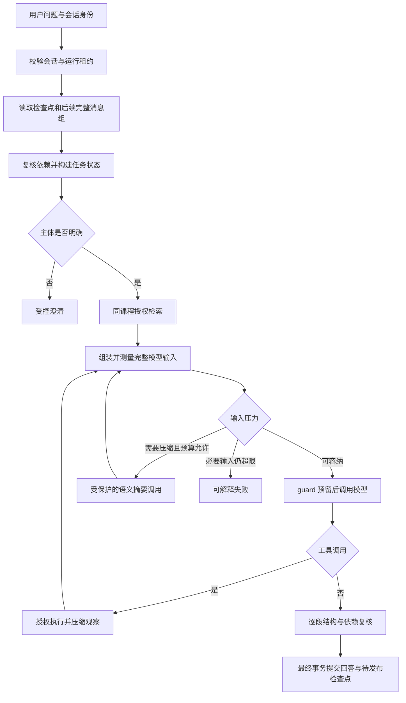

# 学习助理上下文管理重构方案

编写日期：2026-10-21。状态：**待实施方案，不是功能交付记录**。

基线为本机 `master@680675fabe45bddb68f9c412deb1f00a95414c1e`，核验时工作区干净。本文在 `feature/assistant-context-redesign-plan` 编写。实施前重新检查 Git、当前代码和配置，保留后续变更；不自动合并或推送。

## 1. 目标和成功标准

将当前“按固定比例选历史、截取用户原话、关键词拼接上一问”升级为围绕任务连续性运行的上下文管理：保存用户目标与修正，按实际输入压力压缩较早对话，重启后恢复有效摘要，并对过大的工具观察提供可控回读。

完成后应支持下面这条连续流程：用户比较两种缓存方案，明确否定其中一种，要求结合个人进度安排练习；中间经历多轮工具查询与一次上下文压缩，刷新或重启测试服务后追问“继续刚才第二步”。系统应识别当前任务、保留否定与约束、查询当前进度、在歧义时澄清；资料切版或权限变化后不能继续发送旧的资料结论。

成功标准分三类，分别验收：

- 工程正确性：完整消息组、预算扣账、取消、幂等、事务恢复、依赖失效均有可重复的 Fake/HTTP Mock 或隔离数据库证据。
- 上下文行为：用户修正、任务推进、主题切换、摘要覆盖与工具回读有冻结场景及输入快照断言。
- 回答质量：真实模型是否理解摘要、选择正确工具、诚实处理资料不足，需要另行授权的生成评测；Mock 不能给出真实质量结论。

## 2. 当前基础与问题

先读 [交接文档](ASSISTANT_HANDOFF_20261020.md)、[原分阶段计划的实施更新](LANGCHAIN4J_AGENT_PHASED_PLAN_20261017.md)、[上下文实施记录](ASSISTANT_CONTEXT_ENGINEERING_20261020.md) 和 [检索门槛记录](ASSISTANT_RETRIEVAL_THRESHOLD_20261021.md)。旧交接正文包含历史快照，当前代码优先。

| 当前实现 | 保留的价值 | 本次需要替换或补充 |
| --- | --- | --- |
| MySQL 正式消息与运行、幂等和租约 | 事实历史及成功提交边界 | 增加可恢复上下文检查点 |
| 最多 48 条候选，完整已完成回合复核 | 排除失败、越权、过期回答 | 分页读取和增量覆盖，避免把 48 条当会话终点 |
| `ChatContextPlanner` 用剩余空间的一半准入历史 | 输入硬限与累计成本防线 | 根据必要内容和压力选择完整组，不固定分配一半 |
| `ConversationSynopsis` 最多 4 条、每条 160 code points | 可追溯用户摘录 | 结构化语义摘要；摘录不能称为完整总结 |
| `ConversationQueryPlanner` 关键词找上一明确问题 | 少量指代追问 | 基于任务状态的主体选择与歧义澄清 |
| `EvidenceBook`、历史 Codec、IO scope、运行 guard | 权限/版本/偏好复核及取消、限额 | 全链复用，禁止用摘要绕过 |
| LangChain4j AI Services、ChatMemory、只读工具 | 受控工具循环与输入承载 | 上下文控制放在现有调用边界，不增加 Agent 框架 |

最新基线还包含流式突发分片修复、混合检索语义门槛和 Mem0 配置修复；重构不能覆盖它们。合法引用编号不等于回答得到证据支持，既有错误事实负向探针仍应保留。

## 3. 两个参考项目的取舍

以下是本机源码静态审计，未运行参考项目测试。路径用于本机复核，不是 LearnHub 的运行依赖。

| 参考源码位置 | 可借鉴机制 | LearnHub 的适配决定 |
| --- | --- | --- |
| `D:\Project\Agent\mewcode-java\src\main\java\com\mewcode\compact\ContextCompactor.java` | 每轮检查压力、软硬阈值、压缩旧前缀、保留近期完整组、失败次数限制 | 按现有 guard 内的预算执行；硬限不能绕过，压缩失败不无限重试 |
| 同项目 `conversation/ConversationManager.java` | 最近 usage 锚点与追加消息估计 | 只校准上下文占用；请求结构变化使锚点失效；不复制其他供应商缓存 Token 求和 |
| 同项目 `session/SessionManager.java` | 追加式 compact boundary、恢复摘要与后续消息 | 用 MySQL 事务和版本 CAS；不复制 JSONL 的最佳努力写入 |
| 同项目 `toolresult/` | 大工具结果预览、外置、回读 | 使用服务端授权结果引用，不提供任意文件读取 |
| `D:\Project\Agent\SuperBizAgent-release-2026-05-17\src\main\java\org\example\service\AiOpsService.java` | Planner/Executor 的显式计划与反馈状态 | 借鉴任务状态字段，不引入 Spring AI Alibaba 或多 Agent 执行框架 |
| 同项目 `controller/ChatController.java`、`service/ChatService.java` | 内存会话窗口和事件分流 | 固定轮数窗口与内存 Map 不作为升级目标；工作流状态不等于持久会话记忆 |

不复制编码助手的隐藏推理记录、任意本机文件访问或上下文溢出后的无保护重试。LearnHub 的摘要只保存可展示任务状态和必要对话内容。

## 4. 架构与一次请求流程



任务状态、摘要、近期消息和当前证据分别渲染。历史引用编号不跨轮复用；课程事实仍从本轮复核后的证据账本取值。摘要和查询改写均不得进入 system 规则或扩展 owner/course 范围。

### 4.1 上下文结构

建议先用普通 Java record/值对象实现下列概念，不预先建立通用插件或评分框架：

| 部分 | 内容 | 来源与信任边界 |
| --- | --- | --- |
| 固定规则和工具 schema | 行为规则、课程范围、输出协议 | 服务端版本控制，必要输入 |
| 当前问题 | 当前原文及澄清选择 | 用户输入，必要输入，不能被摘要替换 |
| 任务状态 | goal、topic、constraints、decisions、corrections、openQuestions、nextStep | 从正式消息提取，标注消息序号；用户主张不是课程事实 |
| 滚动摘要 | 对已覆盖较早完整组的语义归纳 | 不可信模型产物，严格 schema，保留溯源和依赖 |
| 近期完整消息组 | 用户/助手对及本轮完整工具链 | 原文优先，不能拆调用和结果 |
| 当前证据和偏好 | 资料、目录、进度、偏好快照 | 经现有授权与版本复核；偏好只影响表达/安排 |
| 工具观察 | 完成状态、相关字段、结果引用 | 后端生成；模型不能声明工具已经成功 |

任务字段用 `value + sourceMessageSeqs + dependencyKeys` 表达。模型归纳的结论标记为推断；没有直接用户表达，不记录“用户已掌握”。最新明确修正覆盖旧选择，保留修正来源。摘要不保存隐藏思维链。

第一版对摘要采用**整份失效**，不尝试删除失效引用后保留相关结论；字段级依赖用于溯源和未来优化。任务状态与摘要同一检查点保存，不分别推进游标。

### 4.2 两本预算账

**成本账**继续由 `AssistantRunGuard` 负责：调用次数、工具次数、累计预留、实际 usage、日限额、截止时间；摘要和可选查询改写都是付费调用，提前预留，失败/未知用量不退款。

**上下文占用账**由规划器负责：本次完整序列化请求的 UTF-8 字节、模型输入 Token 估计、工具 schema 与输出预留。它只决定是否压缩和怎样排布，不修改成本账。

第一版不降低现有字节换算预留的保守策略；不要将“UTF-8 字节近似 Token 上界”写成供应商精确保证。硬检查始终执行：

```text
requestBytes <= maxInputBytes
reservedRunTokens + conservativeInputReservation + outputReservation <= maxRunTokens
estimatedInputTokens + outputReservation + safetyMargin <= configuredModelWindow
```

模型窗口须由已验证配置显式提供，不猜测模型名对应窗口。usage 只能在返回后校准估算：保存实际 input usage、当次请求指纹和消息边界；完全相同前缀才可加追加部分估计。system/schema、摘要、偏好、证据顺序或内容变化均使锚点失效。锚点不复用到其他用户、会话或模型。第一版若无法证明前缀一致，直接重新估计。

### 4.3 触发与选择策略

- 对当前组装请求计算三类压力：字节占硬限、估计 Token 占有效窗口、下一调用预留占剩余成本；任一硬限不可突破。
- 软阈值建议从有效输入空间的 75% 开始，目标压缩后回落到 55%；这是待测试的初始配置，不是效果结论。硬线是上述硬检查，不能仅依赖百分比。
- 保留当前问题、规则、所需当前证据、正在执行的完整工具链；为下一批工具观察预留一个可配置的估计空间，不能无限预留或固定把一半给历史。
- 最近完整回合按“最新组优先”保留，目标为最近至少两组；它是软目标，超限时允许减少并报告。较早组连续前缀进入摘要，不能跳过中间组却宣称全区间已覆盖。
- 只有存在可压缩前缀、摘要调用能装下、且调用后仍能为下一次回答预留预算时才压缩。每个 run 第一版最多一次摘要调用，摘要失败本 run 不重试。
- 软触发失败：如仍低于所有硬限，保留旧有效检查点并按完整组减少历史继续；若需牺牲任务信息，记录降级原因。硬超限：确定性工具投影、删除可选历史后仍装不下，则 HTTP 前失败，不盲目重试。
- 流式首段发出后不启动摘要或语义查询改写；后续检查失败终止运行，不能把已发文本当作可撤回。

## 5. 语义摘要协议

输入仅包括上一份有效摘要、连续新增且已复核的完整较早回合、消息序号和依赖身份。压缩当前工具链或读取未完成回答均不允许。摘要调用复用现有受控 HTTP、IO scope、guard 和 usage 记录模式，不开启隐藏重试或后台脱离运行。

输出为严格 JSON：`schemaVersion`、`taskState`、`conversationSummary`、`unresolvedReferences`；每个条目必须带输入中存在的消息序号。拒绝额外字段、未知依赖、伪造序号、超长数组/字符串、外部链接和非法 JSON；摘要本身与依赖信封合计计入输入预算。限制值在阶段 B 用 fixture 固定，不截断序列化 JSON。

摘要提示词要求保留用户否定、改正、数字约束、选定方案和下一步；不把先前助手结论重新认证为事实。schema/序号校验只能证明结构和来源身份，不能证明语义忠实；真实模型的压缩失真必须单独评测。

未达到阈值不调用摘要模型。摘要失败且可以降级时不用用户摘录伪装成功摘要；记录 `SUMMARY_FAILED`，保留原成功检查点。现有 `user-extract-v1` 只用于关闭新功能时的旧路径，不转换成新语义检查点。

## 6. 持久化与恢复

### 6.1 建议数据结构

新增 `assistant_context_checkpoint`，第一版每会话维护一个当前检查点，正式消息始终保留。下列为逻辑字段，实施时补齐 SQL 类型、长度、索引及全部中文 COMMENT，并同步 `sql/schema.sql` 和版本迁移：

| 字段 | 含义 |
| --- | --- |
| id、owner_id、conversation_id、course_id | 归属和课程范围；conversation_id 唯一 |
| revision | CAS 版本号；首建与并发冲突均须处理 |
| covered_through_seq | 最后覆盖的已完成助手消息序号；不使用消息数量当游标 |
| covered_input_hash | 被覆盖消息及依赖的有序内容摘要，防止复用不匹配输入 |
| summary_json、dependencies_json | 结构化摘要/任务状态及现有 Codec 能验证的依赖信封 |
| schema_version、prompt_version、model_identity | 摘要兼容性和追溯，禁止存密钥 |
| source_run_id | 发布检查点的成功运行 |
| created_at、updated_at、deleted | 通用审计与逻辑删除字段 |

覆盖 hash 不要求每次全量扫描历史：正式消息应不可变；读取时核对边界、归属、版本与依赖，构建/重建时按有序原始输入计算 hash。若未来允许编辑正式消息，必须增加会话历史 revision 并使旧检查点失效，不能只比较旧 hash 字符串。

### 6.2 提交语义

1. 运行内生成 `pendingCheckpoint`，内存使用前验证 schema、溯源及依赖；这时可以用于本轮回答，但还不是已发布检查点。
2. 最终 `book.check` 后，扩展 `ChatPersistenceService.complete` 的同一事务：核验 owner、RUNNING、lease owner 和租约有效期，重新确认覆盖边界、原始消息身份及 `covered_input_hash` 对应输入，写正式回答/usage，并以期望 revision 写检查点。当前取消提交保护依靠运行状态/租约及执行协调锁，不假设存在独立取消字段。
3. 摘要依赖必须合并到本轮证据复核集合，不能只在生成摘要前检查一次。应用复核与数据库提交之间仍有时间窗口，复用现有并发约束，不能承诺跨系统原子撤权。
4. CAS 冲突时放弃本次检查点发布，保留现有检查点，回答仍按既有有效完成条件提交；不得覆盖较新游标。数据库异常则整事务回滚。
5. 取消、超时、模型失败、租约丢失、事务回滚均不能推进覆盖序号。重复 `clientRequestId` 不重复摘要调用或发布。新请求重试可以重新压缩，但必须重新扣账。

### 6.3 恢复与失效

- 首先校验会话归属及课程，再检查 schema/prompt 兼容、边界消息和完整依赖；禁止在验证前向模型发送旧摘要。
- 恢复有效摘要，按会话全局 seq 分页读取边界后的正式消息，跨分页保留未配对组，重建完整组；不能只查询助手消息或把页尾当作完整组边界。工具协议记录如需恢复，保存/读取完整结构，不从展示字符串猜测调用关系。
- 撤权、材料切版、目录/进度变化、偏好忘记或结构不兼容：整份摘要失效。允许从仍可读的原始完整组重建，失效回合不参与 query、摘要或模型输入。
- 重建有读取上限、字节上限和截止时间，超出时仅用可验证近期组并记录覆盖缺口，不能把未扫描区间写成已覆盖。不得为追求全历史在一次请求发起无限摘要调用。
- 删除会话时同步逻辑删除检查点及外置工具结果。禁用新功能只回退旧路径，不删除正式历史。

## 7. 工具观察与授权回读

先为现有四类只读工具定义确定性投影，例如目录保留节点身份/标题/顺序，进度保留相关课时和完成状态。后端同时保存完整结果及权限/版本快照；模型只拿任务相关字段、总数、是否省略和不透明引用，不使用 LLM 压缩工具执行状态。

新增回读能力按需进入阶段 D：参数只允许 `resultRef`、受限分页/字段选择；owner、course 从当前运行取值。首次执行和每次回读均验证归属、有效期、资料/进度版本；不可读或失效即拒绝。不能接受任意路径、URL、SQL 或跨课程标识。

完整结果存 MySQL 短期结果表，字段至少含 owner/course/run、resultRef 唯一值、工具类型、快照依赖、正文、过期时间及审计字段。设置单结果与单运行总字节上限、页大小和过期清理；过大结果仍可受控拒绝，不能把数据库当无界溢出盘。

调用/结果消息仍成对，结果正文标记投影范围。回读属于工具调用，扣减同一工具次数及期限；不得通过回读跳过 EvidenceBook 检查。结果引用不直接成为可展示课程来源。

## 8. 检索主体与澄清

第一版不为每个问题增加额外 LLM 调用。先使用当前明确实体、任务状态中已选主体、最近完整组及未决引用生成候选：当前明确问题优先；任务切换清理旧的活动主体；否定/修正更新状态。

若“第二个方案”能唯一对应已列出的方案身份，生成独立检索 query，并保存对应消息序号。两个活跃候选无法唯一映射时，返回简短澄清问题及候选，而不是静默选最近一问。澄清也按正式回答/幂等流程持久化，使用独立结果类型，不标成资料不足；纯澄清无需生成调用。

确定性解析只能处理明确场景，不能声称完整语言理解。复杂语义改写作为后续可选项，只有在同一预算内有余量且已有专项质量证据时启用；输出仅用于查询，不成为事实。最终回答仍依据当前复核的证据。

## 9. 分阶段实施与提交门槛

各阶段先写/补行为回归再修改实现，专项通过后根 `mvn test`、`mvn verify`，然后中文 Conventional Commit。数据迁移只在隔离数据库执行，不自动改用户业务库。

| 阶段 | 修改范围与具体交付 | 必须验证的结果 | 建议提交 |
| --- | --- | --- | --- |
| A：冻结与测量 | 审计当前生成器/工具会话；引入完整消息组和输入测量，分离成本/占用；输出选择原因 | 原路径响应不变；工具组不拆；usage 锚点变化失效；硬限 HTTP 前拒绝 | `refactor: 分离上下文占用测量与运行成本保护` |
| B：运行内语义压缩 | 用结构化任务状态/摘要替换固定半额和摘录；压力触发、单次调用、受控降级；暂不落库 | 修正与约束保留；无压力零新增调用；摘要也扣账；失败不循环；必要输入超限关闭 | `feat: 增加预算内任务状态与语义压缩` |
| C：持久检查点 | 表/迁移/Mapper、complete 同事务、CAS、分页恢复与失效重建 | 重启恢复；取消/回滚游标不前移；CAS 无覆盖；权限/版本失效旧文本零次发入后续 Mock 请求 | `feat: 持久化可失效上下文检查点` |
| D：工具观察 | 四类投影与有界结果存储、授权分页回读、清理 | 组完整、回读能补充省略字段、跨用户/课程拒绝、过期和版本变化拒绝、限额不绕过 | `feat: 增加工具观察投影与授权回读` |
| E：主体与澄清 | 任务状态驱动 query、主题切换、唯一映射、独立澄清结果协议 | 多主题歧义必须澄清；明确追问可查询；负向修正不回流；不扩大检索授权 | `feat: 根据任务状态规划追问与歧义澄清` |
| F：集成验收 | 批次执行器、Mock 端到端报告、配置/回退/交接更新 | 下节矩阵有逐项证据；新旧模式对照；实际通过/失败/跳过分别报告 | `test: 验证长对话压缩恢复与安全退化` |

A 不替换行为，B 引入新路径时功能默认关闭；B 到 C 之间仅承诺单 run 内压缩，不宣传跨请求恢复。D 和 E 可以在 C 稳定后分开交付，不需要等待新增框架。若触及前端澄清展示，还须执行前端测试和构建。

拟新增配置应集中于现有 assistant 属性，新增前先更新 `.env.example`：开关、模型窗口、软触发比例、压缩目标比例、摘要输出上限、恢复扫描上限、工具结果上限/TTL。沿用现有调用总数、输入字节和时间限额，不提高默认额度；新增配置必须校验取值关系。`maxSummaryCallsPerRun=1` 第一版固定，不增加可随意放大的隐藏入口。

## 10. 验收矩阵与证据格式

先冻结新的 `context-redesign` 场景集，保留旧 16 题文件及 `NOT_RUN` 历史状态，不覆盖旧报告。开发者看过的用例标为回归集；真实质量批次另建并冻结。

| 编号 | 场景 | 最小可证明断言 |
| --- | --- | --- |
| C01 | 短对话/低压力 | 与旧行为一致；无摘要请求；成本仅真实发生的调用 |
| C02 | 长对话、用户否定并修正方案 | 摘要包含修正来源，旧选择不再被当作当前决定；保留近期完整组 |
| C03 | 多次跨 run 压缩 | 覆盖连续、不重不漏；旧摘要加新增前缀；单 run 最多一次摘要 |
| C04 | 摘要 JSON 非法/伪造序号/超长 | 不发布、不传入下一模型；usage 已扣账；软降级或硬拒绝符合条件 |
| C05 | 剩余调用/Token/时间不足 | 不发摘要 HTTP；不超支；最终失败原因明确 |
| C06 | 首次建立及恢复 usage 锚点 | 改 system/schema/证据/偏好即失效；估计不能减少累计预留 |
| C07 | 大工具结果及回读 | 调用结果配对；省略标记真实；授权回读补足；二次读取计工具次数 |
| C08 | 模型/摘要中途取消、超时、重试 | HTTP 可中止，未知用量不退；检查点不前移；相同请求不重复执行 |
| C09 | 提交回滚、租约失效、CAS 冲突 | 隔离 MySQL 中验证回答与检查点的事务行为和冲突规则 |
| C10 | 测试服务重启 | 相同 owner/course 恢复摘要和后续完整组；不同用户读不到 |
| C11 | 撤权、切版、目录/进度变化、忘记偏好 | 旧摘要/依赖不发送，回读拒绝，失效重建不放宽课程范围 |
| C12 | 两方案歧义、明确指代、切话题 | 分别澄清、选定正确 query、清除旧活动主体 |
| C13 | 无限工具/摘要诱导及提示词注入 | 调用总量/输入限制生效；摘要不升级成 system 权限 |
| C14 | 弱证据与错误合法引用 | 保留现有负向探针，区分来源有效与语义充分，不将 Mock 接受错误内容算质量通过 |

每项报告写：代码 HEAD、场景版本、配置开关（脱敏）、执行命令、实际输入/输出断言、模型/摘要/工具调用数、预留及实际用量、压缩前后大小、覆盖边界、最终状态和未验证项。日志只写计数、枚举原因、内部标识，不记录完整问题、摘要正文、密钥或签名 URL。

真实生成质量至少评估任务连续性、用户约束保留、压缩忠实度、澄清必要性、事实支持和诚实拒答，分项记录人工判定与反例。不能把来源 Recall、合法 E#、结构校验或阈值调优作为上述指标的替代。

## 11. 验证操作、回退和不可变约束

```powershell
Set-Location D:\Project\myproject\LearnHub
git status --short
git branch --show-current
git rev-parse HEAD
& 'D:\Android\apache-maven-3.9.10\bin\mvn.cmd' test
& 'D:\Android\apache-maven-3.9.10\bin\mvn.cmd' verify
```

专项测试命令在每阶段根据实际新增测试类填写，不提交不存在的测试命令。单一执行者顺序运行 Maven，避免共享构建目录被并行任务覆盖。数据库测试用独立容器/随机端口，核对表/字段注释、索引、逻辑删除及迁移重跑；测试结束清理本次进程与容器，不停止用户服务。

回退通过配置关闭新上下文路径；旧消息、证据信封和旧路径保持兼容，新检查点不再读取/写入，工具外置记录按 TTL 清理。代码回退不自动删表或历史，不执行破坏性 down migration。默认关闭的新开关通过 Fake/Mock 验收后再由后续实施任务按实际授权启用。

持续约束：JDK 17 / Boot 3.3.5；不重做阶段 0，不更换框架，不重导资料/向量/媒体，不重启用户后端。付费烟测已用满三次，既有台账不重置；摘要、改写、自动偏好提取也不能成为额外付费旁路。本文只授权后续实施的技术路线，不增加真实调用额度。

## 12. 下一位实施者的起手任务与本文验证边界

从最新代码创建独立功能分支，先完成阶段 A：读根约定与本文，核验当前生成器、`ChatContextPlanner`、`ToolStreamingSession`、`ChatEvidenceCodec`、`EvidenceBook`、`ChatPersistenceService.complete` 和成本 guard；运行当前相关回归，冻结消息组/预算/取消基线，再开始测量职责拆分。

本文交付只进行了仓库/参考源码静态核对和 Markdown、链接、路径、差异检查；未实现新类、新表、配置或模型调用，没有运行 Maven、参考项目测试、真实模型或业务基础设施验收。后续每阶段将实测结果追加到新的实施记录，并链接本文；不得把本文阶段表改写成已完成状态。
