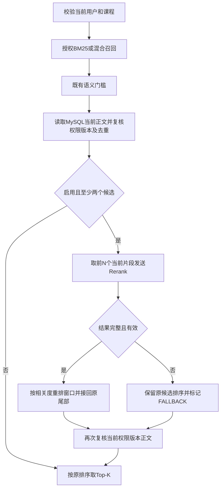

# SiliconFlow Rerank 设计与实施记录

日期：2026-10-26。设计基线为干净的 `feature/siliconflow-embedding@dca71bc`；在其上创建 `feature/siliconflow-rerank`，保留尚未合并的远程 Embedding 前置能力，不自动合并或推送。本文先提交设计，再按阶段实施并追加实测结果；设计条目不代表已经完成。

## 1. 目标与范围

在既有授权 BM25 / BM25+BGE+RRF 检索后增加交叉编码器重排，使最终返回的资料更贴近问题。调用 [SiliconFlow Rerank API](https://api-docs.siliconflow.cn/docs/api/rerank-post)，模型固定为用户指定的 `BAAI/bge-reranker-v2-m3`。

沿用现有 JDK17 / Boot3.3.5，无新增依赖、数据库表或向量回填；不更换 Embedding、聊天生成模型和 Mem0。Key 复用本地已忽略的 SiliconFlow 配置，不写入源码、文档、日志或提交。不开启 DeepSeek 付费烟测，不重置既有台账，不重启用户后端。

Rerank 改变候选顺序，不能召回原候选之外的资料，也不等于证据充分性判断。既有语义门槛仍位于融合之后、重排之前；被门槛排除的资料不通过 Rerank“复活”。不沿用未经标定的 Rerank 过滤阈值。

## 2. 请求流程与授权边界



1. 首次召回仍以当前身份的 readableLessonIds 过滤，MySQL 是正文与版本事实源。
2. **上传前**过滤不属于当前课程、不可读、旧版本、重复或缺失的片段。不能把ES/PG正文或全部未授权候选直接发给供应商。
3. 默认从当前合法序列取前20个片段，配置范围2～50；每次检索至多一次 Rerank HTTP 调用。正文发送原完整片段（既有上限600 UTF-16单元），不静默截断正文冒充全片。
4. 成功时只重排窗口，窗口后的候选保持原相对顺序，用于重排后撤权等情况的补位。每个片段仍以 `chunkId+documentId+sourceVersion` 绑定原身份，远端 index 仅是位置映射。
5. 外部调用成功或失败后均重新查询当前权限和MySQL片段；版本、正文、标题、heading或顺序与上传快照不一致的候选整条排除，再截取最终limit（现有1～10）。回源正文用于响应，不信任供应商回传的document文本。
6. 跨系统不能原子阻止复核后的即时撤权，也不能撤回已合法发送给远端的文本；复用后续 EvidenceBook 校验，不承诺零时间窗口。

## 3. 远程协议和输入输出约束

Endpoint：`POST https://api.siliconflow.cn/v1/rerank`，请求头 `Authorization: Bearer <本地Key>`。

```json
{
  "model": "BAAI/bge-reranker-v2-m3",
  "query": "用户的检索问题",
  "documents": ["MySQL复核后的片段A", "MySQL复核后的片段B"],
  "top_n": 2,
  "return_documents": false,
  "max_chunks_per_doc": 1,
  "overlap_tokens": 0
}
```

`top_n`等于实际上传数量，取回完整窗口后由本地取Top-K，便于撤权补位。`instruction`仅用于Qwen，BAAI请求不发送该字段；不为Rerank query添加Embedding检索前缀。

返回仅消费`results[].index`和`relevance_score`。必须恰好覆盖全部上传index，索引为整数、唯一且不越界，分数为有限数；拒绝缺项、重复、非法JSON和非有限分数。由于协议未明确保证分数范围，不将[0,1]作为通用输入契约，也不把分数解释为概率。按score降序、原index升序处理同分，远端document字段不进入事实源。

请求体最多128 KiB、响应最多128 KiB。Unicode完整，query1～500 UTF-16单元、单片段1～600，批次数量不超过配置且最多50。超限时不发HTTP，按重排失败保留原排序。空或单条候选直接SKIPPED，不调用供应商。

## 4. 实现边界

- 新增小型`KnowledgeReranker`契约，仅包含候选窗口和排名结果；`SiliconFlowReranker`负责HTTP与严格解析，`RerankConfiguration`负责可选Bean。
- 复用现有Embedding/Mem0客户端的JDK HTTP、有限响应订阅、scope取消、完整响应截止和脱敏错误模式，不在本阶段重构已验收的Embedding客户端。
- `KnowledgeRetrievalService`插入重排及二次复核；既有构造器保持兼容，直接构造的旧测试默认禁用重排。
- `Result`新增独立`rerankMode`：`DISABLED`、`SKIPPED`、`APPLIED`、`FALLBACK`。`retrievalMode`仍为原`BM25/HYBRID/BM25_FALLBACK/NONE`，`Source.score`保留原召回分数；不混合不同量纲，不改变资料引用身份。
- 不新增前端交互。当前资料检索工具和问答入口共用该服务；纯课程搜索等不经过该服务的工具不会因此重排。

## 5. 取消、成本与故障

默认远端时限5秒，允许100ms～10秒；聊天scope更短时使用其剩余时长，取消future和完整响应体等待。`ASSISTANT_CANCELLED`及`ASSISTANT_DEADLINE_EXCEEDED`必须透传，不能标记FALLBACK继续生成。普通供应商超时、401/400/429、非法响应、服务关闭或容量满则回到原排序。

全局远程在途请求最多2个，不排队等待；每次检索最多1次，无隐藏重试。现有工具调用次数、运行截止和生成预算保持原含义。Rerank不是聊天生成调用，不能拿DeepSeek三次台账记作Rerank额度，也不虚构其已包含供应商费用；本阶段通过候选数、正文长度、单次调用、并发与超时控制放大成本，不新增日计费配额系统。

生产只允许官方HTTPS地址；HTTP仅允许回环Mock；不跟随重定向。错误仅记录受控类型/HTTP状态，不输出Key、请求/响应正文或签名URL。

## 6. 配置、启用与回退

新配置统一在`learnhub.rerank`，放全局`application.yml`，不绑定vector profile，以支持BM25单路及向量故障降级后的重排：

| 环境变量 | 默认值 | 说明 |
| --- | --- | --- |
| `LEARNHUB_RERANK_ENABLED` | false | 模板默认关闭；验收后本机设true |
| `LEARNHUB_RERANK_API_KEY` | 空 | 非空时独立覆盖；为空时复用`LEARNHUB_VECTOR_SILICONFLOW_API_KEY` |
| `LEARNHUB_RERANK_ENDPOINT` | 官方`/v1/rerank` | 可选覆盖，受地址白名单约束 |
| `LEARNHUB_RERANK_TIMEOUT` | 5s | 独立远程超时，不覆盖运行截止 |
| `LEARNHUB_RERANK_CANDIDATES` | 20 | 2～50，越界配置启动拒绝 |

先补`.env.example`空Key示例，再仅更新被Git忽略的本地`.env`开关；不重复抄写实际Key。关闭开关后无Rerank Bean，恢复原召回排序；模型和向量数据不变，无需重建资料或清库。配置在用户正常启动后端时加载，代理不重启日常服务。

## 7. 实施阶段及验收矩阵

| 阶段 | 交付 | 验证/提交门槛 |
| --- | --- | --- |
| 0 文档 | 本设计、协议、范围和边界 | 链接/路径/Markdown检查；中文docs提交 |
| 1 实现 | HTTP适配器、可选配置、授权重排入口、Mock回归 | 专项后根mvn test和verify；中文feat提交 |
| 2 实测与交接 | 小规模真实接口/业务只读烟测、本机配置、实测结果 | 不伪装降级、不改权限、不调用聊天生成；中文docs提交 |

必须覆盖：

1. Mock验证Bearer、指定模型、完整top_n、无instruction及无Embedding前缀；逆序映射/同分排序。
2. 400/401/429/超时不重试；索引缺失/重复/越界、小数index、非法分数、重复JSON字段、超大/慢响应拒绝；错误不含Key或正文。
3. scope调用前取消零HTTP、在途取消、scope截止透传；普通超时仍可降级；关闭组件取消在途并释放资源。
4. enabled/disabled、缺Key/非法配置、Key复用、零/单条候选、窗口上限、初始未授权候选零上传。
5. 第二十名以前的相关候选可被提升到最终Top-K；失败保留原顺序；原召回模式、分数、candidateLimitReached保留。
6. Rerank等待中发生退款、资料切版、删除或正文变化，最终不返回旧快照；恶意远端正文不能替换MySQL正文。
7. BM25/HYBRID/向量故障回退路径均可重排；空候选不调用；ES故障仍按原规则失败。

构建串行执行，临时HTTP Mock使用随机回环端口并finally清理；根测试包括既有基础设施条件跳过，实际执行/跳过数分别报告。真实烟测至少一个明确相关/无关资料排序和一次真实应用出口的授权/版本核对，记录成功、降级及延迟；不据小样本宣称总体效果提升。

## 8. 实际执行记录

尚未实施。后续追加实际命令、结果、提交和未验证边界，保留首次失败证据。
