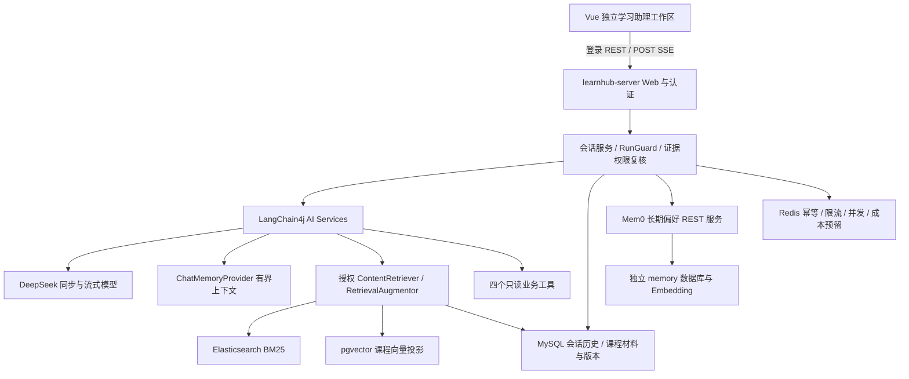

# LearnHub：LangChain4j 完整学习助理分阶段实施文档

> 2026-10-18 实施更新：已核验起点 `feature/assistant-rag-agent@73a1764` 和初始干净工作区。阶段 0 已提交 `5042eb9`，取消补实验为 `458540e`（隔离测试合计 14 项）。阶段 1 为 `9d07854`（19 项专项测试）；阶段 2 已实现独立工作区与 Fake SSE，后端 verify 341 项/67 跳过、前端 98 项/构建通过，三个视口浏览器 Mock 验收通过。详细边界见 [实施记录](ASSISTANT_CHAT_IMPLEMENTATION_20261018.md)。阶段 3 已接入生产 LangChain4j 流式/ChatMemory，最终根 verify 360 项/69 跳过、隔离 MySQL 21 项无失败。已授权真实烟测累计 3 次：首次失败，修复重复请求字段后带受控历史的追问成功（3 批，324 Token），首字后取消通过；合计 11592 Token 预留，失败/取消用量未知，不重置额度。阶段 4 已接入框架切分/授权 Retriever 与 Augmentor，根 verify 377 项/71 跳过无失败；真实隔离 MySQL/ES 9 项及已见开发集 8 条通过，业务库未重导入。阶段 5 已实现本地中文 Embedding、独立 PG profile/私有池、版本化投影补偿与 RRF；底座提交 f460ed2，最终根 verify 420 项/82 跳过无失败，隔离向量专项 14 项实际通过。首次既有开发集来源 Recall@5 两者均 6/6，混合更慢且无证据题仍有弱召回，默认关闭，未证明质量提升；完整结果见向量安装记录。阶段 6～8 尚未验收。下文“本轮未实施”等描述属于 2026-10-17 的设计快照，当前进度以本段和实施记录为准。

编写日期：2026-10-17。性质：待实施设计及交接文档。本次仅核对本仓库、两个参考项目与官方资料，没有安装依赖或中间件、执行付费请求、重启服务，也没有实现下列新模块。

## 1. 本次重新确定的目标

将现有课程单轮答疑升级为 **LangChain4j 驱动的完整 Agent 聊天助手**：独立问答页面、真正的流式输出、数据库会话历史、连续追问、文档切分、课程 RAG、模型自主工具调用，以及后续 Mem0 长期学习偏好记忆。

用户已明确选择 LangChain4j，取代旧方案“不引入 AI 框架”的限制；文档切分和向量检索进入本路线，不再沿用旧方案将它们全部排除在主线之外的范围。保留 JDK 17、Spring Boot 3.3.5、现有业务系统与 DeepSeek 官方 API，不自动升级 Boot，不同时接入 Spring AI Alibaba。

本轮交付是实施文档，以下阶段均未开始。旧 [A～F 方案](RESUME_RAG_AGENT_IMPLEMENTATION_PLAN_20261016.md) 作为历史过程保留，后续框架迁移、流式和记忆开发以本文为准。旧方案所述“模型只有 Fake、Agent 未实现”已经过时。

完成演示应能连贯执行：

1. 打开“学习助理”，选择 Redis 课程，问“热点缓存失效后，怎样避免请求同时打到数据库？”，实时显示回答和课时来源。
2. 继续问“刚才的方法有什么局限？”，模型能够理解前文；刷新页面、重启测试后端后仍能读取正式历史。
3. 问“结合我的学习进度，建议下一步学什么？”，展示查进度、查目录等实际工具步骤并生成建议。
4. 停止生成后不再追加回答；失败可手动重试，重复网络请求不触发重复付费运行。
5. 记住“我每晚只有二十分钟，喜欢先看例子”的偏好，在新会话中使用，并能查看、修改和忘记该偏好。这个跨会话功能由长期记忆阶段交付。

## 2. 当前基线：保留什么，补齐什么

本轮静态核对 HEAD `4499054`、`feature/assistant-rag-agent`，初始工作区干净；历史测试结果没有在本轮重新执行。

| 能力 | 当前证据 | 后续处理 |
| --- | --- | --- |
| 材料导入、切块、版本与补偿 | `assistant/knowledge/KnowledgeChunker`、`KnowledgeIndexSyncService` | 保留版本/补偿，增加 LangChain4j 切分策略版本和向量索引状态 |
| ES BM25 授权检索 | `KnowledgeRetrievalService`、`KnowledgeJdbcRepository` | 改造成授权 `ContentRetriever`，保留 MySQL 正文与权限复核 |
| DeepSeek 真实生成 | `assistant/model/DeepSeekChatModelClient`，请求明确 `stream=false` | 用 LangChain4j 同步及流式模型替换生产协议实现；保留 Fake/Disabled |
| 单轮 RAG 与引用 | `CourseQaService`、`EvidenceBook`、`GroundedAnswers` | 复用来源和校验规则，适配聊天及流式最终确认 |
| 受控工具循环 | `CourseAgentService`、`AssistantTools` | 使用 LangChain4j AI Services 编排，业务工具和限制继续生效 |
| 安全、预算及异步认证 | `assistant/runtime/`、JWT ASYNC 修复 | 每个框架内部模型调用也要走保护，不只包住最外层接口 |
| 课程页问答卡片 | `learnhub-web/src/components/CourseAssistantPanel.vue` | 保留课程入口，增加独立聊天工作区 |
| 会话历史 / ChatMemory / 真流式 | 无对应持久化表和独立聊天路由；现有请求只组织本次工具循环消息 | 本路线新增 |
| Embedding / pgvector / Mem0 | 本轮未见这些生产实现 | 分阶段新增，不能算已完成 |

历史真实验收见 [DeepSeek 验收](ASSISTANT_DEEPSEEK_LIVE_ACCEPTANCE_20261017.md)：累计 23 次模型调用、20997 Token；首次留出 20 项为 19 通过、1 错误拒答；已验证 Agent 读取真实空进度，非空学习进度建议仍有验收缺口。这些数字属于旧实现，不能充当 LangChain4j 版本验收结果。

## 3. 两个参考项目的实际借鉴范围

以下为本地代码阅读结果，没有启动参考项目或复跑它们的测试；路径相对各自项目根目录。参考意味着学习设计，复制代码前另查许可证及复用条件。

### 3.1 `D:\Project\Agent\mewcode-java`

项目是 Java 21、Gradle、自写 Agent / OpenAI-compatible 客户端，不使用 LangChain4j。

| 具体文件 | 借鉴内容 | LearnHub 的调整 |
| --- | --- | --- |
| `src/main/java/com/mewcode/llm/OpenAiCompatClient.java`、`StreamEvent.java` | 真正读取模型流，区分文本、工具、结束和错误事件 | 用 LangChain4j 流式模型实现底层协议；不展示隐藏推理 |
| `src/main/java/com/mewcode/agent/Agent.java`、`StreamingExecutor.java` | 模型选择工具、执行、回填、继续的循环；工具进度事件 | 用 AI Services 和受保护的 ToolExecutor；只注册四个课程只读工具 |
| `src/main/java/com/mewcode/session/SessionManager.java` | JSONL 保存会话并恢复消息及工具链 | 改成 MySQL 多用户隔离、消息状态与来源关联；历史工具结果复核后才允许再次发送 |
| `src/main/java/com/mewcode/conversation/ConversationManager.java`、`compact/ContextCompactor.java` | 运行上下文和长会话压缩 | 首版使用有界窗口；后续摘要也要带来源依赖、过期检查和模型成本统计 |
| `src/main/java/com/mewcode/memory/MemoryManager.java` | 长期偏好提取与管理 | 多用户系统使用 Mem0，不能直接照搬用户目录 Markdown |

`history/HistoryStore.java` 仅为输入 prompt 历史，不能代替完整聊天历史。项目未提供课程 RAG、Embedding 或课程权限规则；Shell、文件写入等编码工具不迁入 LearnHub。

### 3.2 `D:\Project\Agent\SuperBizAgent-release-2026-05-17`

实际依赖为 Spring AI 1.1.0、Spring AI Alibaba Agent Framework 1.1.0.0-RC2、DashScope、Milvus；不是 LangChain4j，不能照抄 `ReactAgent` API。

| 具体文件 | 借鉴内容 | LearnHub 的调整 |
| --- | --- | --- |
| `src/main/java/org/example/controller/ChatController.java` | `SseEmitter` 转发 Agent 流 | 增加登录绑定、取消传播、幂等及终态；不采用内存 Map 作为正式历史 |
| `src/main/resources/static/app.js` | fetch 消费 SSE、增量消息与会话列表 | 迁入现有 Vue/Pinia 结构；数据库历史替代 localStorage 聊天记录 |
| `src/main/java/org/example/service/ChatService.java` | 模型与工具集中组装 | 使用 LangChain4j `AiServices`，显式组装以避免重复注册/越权 |
| `src/main/java/org/example/service/DocumentChunkService.java`、`VectorIndexService.java` | 切分、Embedding、写索引分层 | 使用 `DocumentSplitters`，先构建新版本后切换；保留失败补偿 |
| `src/main/java/org/example/service/VectorSearchService.java`、`RagService.java` | 问题向量化、召回、上下文、流式生成 | 使用 pgvector + BM25 混合召回，并加入课程授权、来源版本和引用检查 |

该项目的浏览器 localStorage 与后端内存会话不满足 LearnHub 的跨用户隔离、重启恢复要求。多 Agent Planner/Supervisor 暂不迁入；首版做好一个能自主调用工具的助手即可。

## 4. 目标架构与存储职责



| 数据 | 存储 / 执行者 | 含义 |
| --- | --- | --- |
| 全部正式会话和消息 | MySQL | 页面历史、跨设备读取、重启恢复；不是仅最近 N 条 |
| 本轮可发送上下文 | LangChain4j ChatMemory + 自定义适配 | 从合法历史构建有限窗口，淘汰窗口消息不删除正式历史 |
| 课程讲解稿及版本 | MySQL | 唯一业务事实源，ES/PG 可重建 |
| 关键词 / 语义索引 | ES / pgvector `learnhub_rag` | 召回候选，不决定授权，也不直接当最终可信正文 |
| 跨会话学习偏好 | Mem0 自有数据库 `learnhub_memory` | 学习目标、时间、讲解风格；不能代替实时学习进度与购买权限 |
| 运行控制 | Redis + MySQL 运行记录 | 幂等、租约、限额与结果状态 |

Mem0 与课程向量可以共用一个 PostgreSQL 实例，但使用不同数据库、账号、表和迁移职责。Mem0 是长期记忆服务，ChatMemory 是模型上下文，聊天历史是业务记录；三者分别验收。[LangChain4j 官方记忆说明](https://docs.langchain4j.dev/tutorials/chat-memory/)

## 5. 版本、模型与新增组件决策

### 5.1 LangChain4j 真实使用范围

2026-10-17 官方文档列出 core/open-ai/BOM `1.22.0`，部分集成仍是 `1.22.0-beta32`。候选锁定此 BOM，不用 SNAPSHOT；具体依赖树和兼容性必须在阶段 0 编译验证，**本轮没有完成兼容性实验**。[版本与 JDK 要求](https://docs.langchain4j.dev/get-started/)

当前 Boot 3 Starter 支持范围为 3.5+，LearnHub 是 3.3.5。采用普通 Java 依赖 + Spring `@Bean` + `AiServices.builder(...)`，不接 Starter、不因此升级 Boot；这条路线仍须测试 Jackson、HTTP 客户端和线程关闭行为。[官方 Starter 支持范围](https://docs.langchain4j.dev/tutorials/spring-boot-integration/)

| 功能 | 计划使用的 LangChain4j 能力 |
| --- | --- |
| 模型 | `langchain4j-open-ai`：`OpenAiChatModel` / `OpenAiStreamingChatModel` |
| 助手与工具循环 | `langchain4j`：`AiServices`、`TokenStream`、工具 schema / `ToolExecutor` |
| 短期上下文 | `ChatMemoryProvider`、`MessageWindowChatMemory`、自定义存储适配 |
| 文档 | `Document`、`DocumentSplitters.recursive(...)`、`TextSegment` |
| RAG | 自定义授权 `ContentRetriever`、`RetrievalAugmentor`，EmbeddingModel |
| 课程向量 | `langchain4j-pgvector`、`PgVectorEmbeddingStore`，其 beta 版本按 BOM 锁定 |

这次不是只把现有 HTTP 客户端包一层框架名称；以上模型、记忆、切分、检索、工具编排都要在生产调用链出现。暂不引入 `langchain4j-agentic` 多 Agent 实验模块。

### 5.2 DeepSeek 与 Embedding

继续使用官方 DeepSeek，当前模型名 `deepseek-flash`；官方模型表支持 JSON Output 和 Tool Calls。配置限定非思考模式及较小输出上限，不能直接照搬供应商最大额度。[当前模型表](https://api-docs.deepseek.com/quick_start/pricing/)

使用 OpenAI-compatible 地址 `https://api.deepseek.com/v1`；流式工具调用采用 `.accumulateToolCallId(false)`，覆盖完整工具 ID 在多个 chunk 重复的兼容测试。关闭原始请求/响应日志。usage 缺失、断流及取消计费行为在适配验收中单独记录；取消连接不能保证供应商免计费。[官方兼容说明](https://docs.langchain4j.dev/integrations/language-models/openai-compatible/)

Chat 模型与 Embedding 分开选择。当前所核官方模型目录未提供可直接据此配置的 DeepSeek Embedding，不能假设聊天 Key 同时提供向量服务。课程向量首选实验候选 `langchain4j-embeddings-bge-small-zh-v15-q`，以本机 CPU 量化模型完成中文验证，避免新增付费供应商；实施前验证许可证、模型下载、实际维度、内存及中文召回，不把候选写成已验证结果。[进程内 Embedding](https://docs.langchain4j.dev/integrations/embedding-models/in-process/)

阶段 5 再增加 PostgreSQL + pgvector；阶段 7 增加 Mem0。Mem0 需要独立可用的 Embedding 配置，不能假定它能直接调用 Java 进程内模型：先验证受限的本地 Embedding HTTP 适配复用同一模型，质量或兼容性不满足再单独评估服务方案，不提前同时安装多套模型服务。

Mem0 使用自部署 REST，Java 薄客户端调用；OSS 路由 `/memories`、`/search` 与托管服务 API 要区分。启用服务鉴权、仅后端访问，身份由登录上下文派生。生成与提取模型也使用明确配置，不能保留示例中的 OpenAI 默认值。[Mem0 REST 文档](https://docs.mem0.ai/open-source/features/rest-api)

## 6. 独立问答模块设计

### 6.1 页面模块：单独工作区，复用现有站点

新增受登录保护路由 `/assistant` 和 `/assistant/:conversationId`，导航名称“学习助理”，与现有“问答”社区区分。课程页按钮跳转 `/assistant?courseId=...` 并预选课程；历史会话固定所属课程，切换课程新建会话。

建议目录（尚不存在）：

```text
learnhub-web/src/
  views/AssistantChatView.vue
  components/assistant/
    ConversationSidebar.vue
    ChatMessageList.vue
    ChatComposer.vue
    ToolExecutionStatus.vue
    SourceReferenceList.vue
    LearningMemoryDrawer.vue
  api/assistant.ts
  stores/assistant.ts
```

桌面布局：

```text
现有站点导航：课程 / 问答 / 学习助理 / 学习权益 / 个人中心
┌────────────────┬─────────────────────────────────────────┐
│ 新建会话        │ 当前课程 / 会话标题 / 设置                │
│ 搜索会话        ├─────────────────────────────────────────┤
│ 今天            │ 欢迎说明、可直接点击的真实课程示例问题     │
│  Redis 缓存练习 │ 用户消息                                  │
│ 昨天            │ 助手消息（实时生成）                      │
│  学习安排       │ 工具状态 → 来源卡片 → 完成/失败状态        │
│                ├─────────────────────────────────────────┤
│ 记忆管理        │ 输入框 / 发送或停止 / 错误与重试           │
└────────────────┴─────────────────────────────────────────┘
```

交互约定：

- 历史可分页、新建、改名、删除；自动标题首版取首条问题截断，不额外付费调用模型。
- 显示“检索资料 / 查询本人进度 / 生成中”等实际状态，工具折叠详情不展示隐藏思维链。
- 课程回答附课时跳转及来源；问候直接自然回复，通用解释标记“通用知识补充”，课程资料不足时澄清、建议相关问题或说明缺口，禁止伪造课程依据。
- 输出 Markdown 按安全白名单渲染，不执行 HTML 或模型提供的脚本；不使用未过滤的 `innerHTML`。
- 用户上滑阅读时不强制滚动；提供“回到最新”；移动端侧栏抽屉化，输入框不遮挡消息。
- 沿用站点颜色、字体和组件，不新增大幅营销 Hero；输入有标签、按钮可键盘访问，状态播报不逐 token 打断读屏。

UI 技能检索未命中专门的聊天布局规则，首轮设计系统推荐的营销 Hero 不适合本场景；以上聊天布局是结合现有站点的设计决定，不冒充技能数据库结论。

### 6.2 后端：独立业务模块，仍由原服务部署

首版在 `learnhub-server` 中新增 `com.learnhub.assistant.chat` 包，下设 `api/application/domain/persistence/stream`，现有 `model/knowledge/tool/runtime` 逐步接入。新页面和接口独立，不先拆独立微服务或新端口。

此处“模块”首先是完整可演示的业务边界。暂不直接把现有代码全部搬到新 Maven 模块：当前课程权限、Mapper、安全上下文在 server 中，直接搬动易形成循环依赖。需要物理拆分时，再将纯模型/消息/端口抽为 `learnhub-assistant-core`，server 实现课程和认证适配，依赖只能 server → core。

### 6.3 会话、消息和执行记录

拟新增 MySQL 表，全部具备主键、创建/更新时间、中文 COMMENT 和必要逻辑删除字段；同步 `sql/schema.sql` 和版本迁移：

| 表 | 主要字段 / 约束 |
| --- | --- |
| `assistant_conversation` | 不透明会话 ID、owner_user_id、course_id、title、status、version、deleted |
| `assistant_message` | conversation_id、seq、role、content、status、parent_message_id、run_id；会话内 seq 唯一 |
| `assistant_message_source` | message_id、document_id、chunk_id、material_version、source_kind、引用标识；支持整条答案来源失效判断 |
| `assistant_run` | owner、conversation、client_request_id、状态、心跳、模型/提示版本、预算预留、实际 usage、错误码；用户+请求 ID 唯一 |
| `assistant_tool_execution` | run_id、次序、白名单工具名、状态、耗时及安全摘要；不永久保存未经授权的整段工具正文 |

正式 assistant 内容只在完成校验后写入 `COMPLETED`；用户输入和运行失败/取消状态仍可保留，用于展示重试。临时 token 草稿不进入后续 ChatMemory。服务器崩溃后由租约/心跳将遗留 RUNNING 标记中断，不自动重新付费生成。

ChatMemory 从当前合法历史重建窗口，不直接拿整张历史表发送。会话所有权必须查询校验，`@MemoryId` 由服务端绑定用户、课程、会话；同一会话串行运行，禁止多个请求共享可变记忆并发更新。

### 6.4 接口与流协议草案

所有接口都在现有登录体系内，`userId`、角色、URL 不作为模型或浏览器选择的工具权限参数。

| 方法与路径 | 用途 |
| --- | --- |
| `POST /api/assistant/conversations` | 创建课程会话，验证课程可见/可访问范围 |
| `GET /api/assistant/conversations` | 仅本人会话分页 |
| `GET /api/assistant/conversations/{id}/messages` | 本人消息游标分页，并处理失效来源内容 |
| `PATCH /api/assistant/conversations/{id}` | 本人会话改名 |
| `DELETE /api/assistant/conversations/{id}` | 本人会话删除；活跃运行先取消 |
| `POST /api/assistant/conversations/{id}/runs` | JSON 输入 `message`、`clientRequestId`；返回 SSE |
| `POST /api/assistant/runs/{id}/cancel` | 幂等取消本人的执行 |
| `GET /api/assistant/runs/{id}` | 断流后查询状态，完成后读取正式消息 |
| `/api/assistant/memories` | 阶段 7 的本人长期偏好查看/修改/删除接口，细分操作届时实现 |

浏览器使用 `fetch` POST + Authorization header + ReadableStream + AbortController。禁止把 JWT 放 EventSource URL。SSE 包含 `eventId/runId/seq`，事件建议：`accepted`、`status`、`tool_start`、`tool_end`、`delta`、`sources`、`final`、`error`、`cancelled`，另加心跳。

`accepted` 返回后不自动重放 POST。初始 401 与流已建立后的错误分别处理：后者用结构化 SSE 错误表示，不能再修改 HTTP 状态。断流后查 run 状态；首版不承诺逐 token 断点续传。重复 clientRequestId 只返回原 run，不创建第二次供应商调用；主动重试使用新请求 ID 并关联失败消息。

## 7. 真流式、引用与权限必须同时设计

模型 `onPartialResponse` / AI Services `TokenStream` 经后端 SSE 发送到页面，不在生成结束后把全文拆字模拟流式。[官方流式接口](https://docs.langchain4j.dev/tutorials/response-streaming/)

当前 `GroundedAnswers` 使用整段 JSON 终验，不能直接把 JSON 残片作为聊天正文。阶段 3 先验证两种协议后锁定一种：优先正文增量加来源标记，最终提取并校验引用集合；若保留结构化输出，使用有大小/深度限制的增量解析器，仅发送答案文本字段，终态严格解析整个对象。不得用正则猜 JSON 或额外模型“校验”冒充确定性检查。

流式正文在 final 前属于暂定草稿，完成时复核引用 ID、材料版本、课程权限、本人会话归属、输出结束原因和预算，再转正式消息。校验失败或撤权时停止上游、终止运行、清除整条临时回答，不能只去掉引用仍保留原回答。

必须承认实际边界：已经推送并被用户看见的字无法撤回。实施时在发送前、工具返回后、历史重放前、流式批次检查点和最终确认时复核；检查点设置最大缓存时长和大小，验证撤权后的停止窗口。不宣称“流式任意时刻零泄露”，也不以此为由取消流式功能。

历史 assistant 回答、工具结果、摘要和长期记忆若依赖已撤权/失效材料，整条排除出后续模型上下文，并在历史页面按策略隐藏受限正文。不能只隐藏来源标签。首版不做课程内容的自动历史摘要，以免摘要失去来源依赖。

框架模型包装层对**每一次**同步/流式调用执行 RunGuard、证据检查、输入大小、次数/Token 预留与 usage 统计，包括 AI Services 自动工具回合和未来的摘要、改写、Mem0 提取；usage 未知保守计费，不按零处理。流式取消需验证上游连接真正终止、回调停止、数据库和 Redis 许可释放，`SseEmitter.complete()` 本身不等于停止模型。

## 8. 分阶段实施与退出条件

每阶段先实现和针对性验证，再中文 Conventional Commit，不自动合并；若失败修复并复验后才能进入依赖它的阶段。阶段分组可以包含多个小提交，不把全部功能压成一个大提交。所有阶段均需同步文档中的“已完成 / 未完成 / 未验收”。

### 阶段 0：框架兼容性与取消实验

输入：当前 POM、JDK 17、Boot 3.3.5、官方 API。输出：`experiments/langchain4j-compat/` 隔离工程与报告，锁定 BOM 和模块；不先改生产依赖。

验证：本地 HTTP Mock 测同步 JSON、usage、流式增量、重复完整 tool_call_id、超时/断开、供应商错误、请求日志脱敏，以及 AI Services + ChatMemory + 工具组装。依赖树检查 Jackson、HTTP 实现、线程退出；验证每次自动回合可被业务保护层拦截，并明确 SDK 实际取消接口。若高层 TokenStream 隐藏了必要控制，先用可控的底层模型/工具执行适配，不放弃权限复核。

退出条件：相关测试确实执行，兼容/取消缺口明确；未验证前不能写“Boot 3.3.5 完美兼容”。提交例：`test: 验证朗链模型流式与工具调用兼容性`。

### 阶段 1：会话历史与运行持久化

输入：认证主体、课程范围、现有 RunGuard。输出：上述会话/消息/运行表、REST、Fake 连续会话服务、幂等与会话锁。

验证：登录 A/B 相互不可读写；课程约束；分页顺序；重复请求只创建一个 run；同会话并发冲突；租约/服务重启恢复；删除会话取消活跃运行；所有 SQL COMMENT 与数据库实际结构核对。ChatMemory 淘汰不删除正式历史。

退出条件：Fake 会话重启后恢复、跨用户越权全部被拒绝；不要求此阶段真实模型。提交例：`feat: 增加学习助理会话历史与执行记录`。

### 阶段 2：独立问答工作区与 Fake 流协议

输入：阶段 1 REST。输出：独立路由、会话侧栏、消息气泡、课程选择、输入/停止、来源和工具状态；课程页跳转。

验证：确定性 Fake SSE 覆盖 UTF-8 跨包、半包/多事件、网络断开、终态后迟到 delta、401、取消、重复发送、XSS、长文本、375/768/1440px 和键盘操作。Fake 用于展示/协议测试，不能称为真实模型流式。

退出条件：页面能完整演示状态与历史，类型检查和构建通过。提交例：`feat: 新增独立学习助理聊天工作区`。

### 阶段 3：LangChain4j 模型、ChatMemory 与真正流式

输入：阶段 0 已验证依赖、阶段 1/2 契约、本地已有 DeepSeek 配置。输出：Spring 手工 Bean、同步/流式 LangChain4j 适配、受保护 MessageWindowChatMemory、多轮聊天、取消传播，保留 DISABLED/FAKE。

验证：在最终响应结束前浏览器实际收到多个模型 delta；多轮代词追问；窗口裁剪；进程重启后从正式历史恢复；整段 JSON/引用协议适配；模型错误、截断、无 usage、取消时不保存成功答案。模型调用层原有限流、并发、轮次和成本保护从首个真实接口起生效，默认无自动付费重试。

退出条件：HTTP Mock 全过；有限真实烟测分别记录请求数/usage/首字延迟与终止行为，真实执行为零时明确缺口。提交例：`feat: 接入朗链流式模型与会话上下文`。

### 阶段 4：LangChain4j 文档切分与授权 BM25 RAG

输入：现有六份讲解稿与数据库映射、版本和检索服务。输出：`DocumentSplitters` 策略、标题/课时元数据、受权 ContentRetriever / RetrievalAugmentor、流式课程问答和引用。

切分以中文标题/段落和有界重叠为起点，参数写入策略版本；不要把旧 chunk ID 悄悄指向新正文。新切分作为新材料处理版本，先写 MySQL，再投影 ES，成功后受控切换；已有历史引用保留原版本标识并按失效策略处理。导入少量真实材料前重新核对课程/课时映射和内容来源。

验证：同文重复导入幂等、超长段落、中文边界、更新失败补偿；引用只能指向本轮已验证证据；撤权/版本变更期间的多轮和流式；问候不误报“课程资料不足”；课程证据不足不伪造引用；恶意材料不能扩权。

退出条件：开发集检索和来源正确、权限用例通过；已见旧留出集只作回归。提交例：`feat: 使用朗链切分和授权检索增强课程问答`。

### 阶段 5：Embedding 与 pgvector 混合召回

输入：稳定的文档版本/切分、阶段 4 BM25 基线。输出：本地中文 Embedding、独立 PG profile、课程向量表、同步任务/补偿、BM25 + 向量 RRF 融合及可切回 BM25 的开关。

安装前记录固定镜像 tag/digest、端口、数据卷、账号和原因；默认仅绑定回环地址。SQL 放 `sql/postgres/`，不交给 MySQL 初始化。PG 使用独立连接/池，防止新增 DataSource 导致 MySQL 自动配置失效。维度从实际模型获得，记录模型名/版本/归一化/距离函数；换模型新建投影并回填切换，不混写不同向量。

向量数据只保存必要文本/标识/版本和元数据；召回先限制已授权课程，再统一回 MySQL 复核当前正文。元数据字段由服务端白名单决定。异步任务使用可幂等状态，旧版本禁止迟到覆盖新版本，不建立跨 MySQL/PG 的伪事务。[pgvector 集成](https://docs.langchain4j.dev/integrations/embedding-stores/pgvector/)

验证：真实 PG 写入/检索/清理、同义改写、精确词、空召回、索引故障、材料删除、版本切换、投影重建和跨课程越权；对同一冻结集比较 Recall@K、答案支持度、错误拒答和时延，不能用“有向量”当质量提升证据。

退出条件：混合检索具备真实数据证据且可回滚；若质量无提升如实保留结果、调整开发集而不改已跑留出。提交例：`feat: 增加课程向量索引与混合召回`。

### 阶段 6：LangChain4j 自主工具 Agent

输入：聊天工作区、已授权 RAG、四个原业务工具。输出：AI Services 自主决定工具/结束，工具状态推送、真实学习建议。

工具仍限定 `search_courses`、`get_course_outline`、`search_course_materials`、`get_my_learning_progress`。工具执行包装器继续严格解析参数、校验课程、复核登录；任何框架自动调用不得绕开它。显式限制工具回合，例如 3 回合，并继续总模型次数、总工具数、总时间、输入和输出预算、用户/全局限流与并发控制。[官方工具编排](https://docs.langchain4j.dev/tutorials/tools/)

每轮发送前复核全部历史证据，框架自动维护的旧 ToolExecutionResult 不能直接重放；记录来源依赖、过滤整条受污染 AI 回答并重建合法上下文。优先顺序执行工具，使取消、次数和权限判断可控；不引入支付、退款、学习进度修改、SQL、Shell、任意 URL 工具。

验证：模型自主组合至少两个工具；无工具直接结束；非法/重复调用 ID、畸形参数、工具异常、重复循环、预算耗尽、中途退出/撤权、工具失败后停止；真实非空本人进度 + 目录 + 材料生成建议，不能沿用旧空进度测试代替。

退出条件：Mock 循环与安全用例通过，真实模型工具选择和执行数有独立记录。提交例：`feat: 使用朗链工具循环生成个性化学习建议`。

### 阶段 7：Mem0 长期偏好记忆

输入：已稳定的数据库历史和短期上下文；单独的 Mem0 生成/Embedding 方案。输出：自部署 Mem0 REST、身份绑定适配、偏好查看/更改/忘记、新会话记忆检索。

先做“记住这条学习偏好”的明确写入，再做有预算的自动提取；不默认整段上传课程正文或工具返回。默认不记密码/敏感身份/订单/完整讲解稿；偏好不能覆盖系统规则、授权或真实进度。记忆附来源、时间和失效标识，删除会话与删除长期偏好是两个可理解的操作。

Mem0 的自动提取可能自行调用模型，因此必须统一配置提取调用/输出/累计 Token 额度和限流；不能只计 Java 主模型费用。服务端身份标签不是鉴权替代。Mem0 故障降级为无长期记忆聊天，不能使跨用户记忆混用。

验证：A/B 用户隔离；新会话检索偏好；更新冲突及忘记后不再召回；来源受限时不重放；恶意“记忆”注入；Mem0 下线；提取超限；实际模型、Embedding 与记忆操作分别计数。

退出条件：长期记忆闭环实际完成；仅 ChatMemory 不得宣称 Mem0 已接入。提交例：`feat: 接入可管理的长期学习偏好记忆`。

### 阶段 8：系统回归、独立评测与交付

输入：前述全部阶段、冻结的模型/提示/索引/配置版本。输出：可复现演示脚本、测试报告、真实成本台账、部署/回滚说明及据实简历描述。

每轮交付执行针对测试，后端 `mvn test`、`mvn verify`，前端相关 Node 回归、`vue-tsc` 和构建；临时后端独立端口并清理，禁止擅自重启用户已有服务。

新建与开发集分离的独立评测：建议不少于 30 条，包含可回答、资料不足、同义改写、多轮、跨用户/撤权、工具建议、流式中断、记忆隔离；已看过的旧 20 条只能作为回归。首次运行后保留失败，不在原留出上调提示后重写首次成绩；安全断言要求全过，质量指标如实报告分母和错误类型。

真实调用采用持久化批次台账，先最小烟测再扩展；建议初始批次总模型调用不超过 8、单次输出不超过 512、累计实际 Token 上限 12000，结合保守预留提前停止。评测需要更大批次时预先明确上限，所有失败、工具回合、重试和 Mem0 提取都累计，不能重开 JVM 清零预算。无凭据继续 Fake/HTTP Mock，真实调用缺口保留。

退出条件：报告自动化实际执行/跳过数、真实模型请求数、工具选择与执行数、Embedding 数、Mem0 数、首次留出条数和结果；跳过不是通过。无遗留测试进程、无敏感配置提交。提交例：`docs: 记录完整学习助理验收与使用方法`。

## 9. 阶段顺序、回滚与接手清单

依赖顺序：`0 → 1 → 2 → 3 → 4 → 5 → 6 → 7 → 8`。每阶段独立提交；可并行做互不改同文件的测试/页面准备，但不能提前宣称依赖阶段已验收。阶段 3 已可演示完整历史和多轮流式，阶段 6 完成课程 Agent 主闭环，阶段 7 对齐参考图的长期记忆层。

运行开关应分别控制聊天新入口、LangChain4j 路径、向量召回和 Mem0；回滚停用新路径后仍可读取合法历史和使用 BM25 基线。旧实现可在迁移期作为对照，切换验收后移除重复生产模型/循环代码，避免永久维护两套编排。

下一轮直接从阶段 0 开始，不用重新讨论框架选择：

1. 查 Git 状态、当前分支、本文及 `AGENT.md`，保护已有改动。
2. 在隔离工程验证 LangChain4j 模型、流、工具、记忆和取消，再更新版本结论。
3. 按阶段建立会话历史与独立工作区，接口保护随首个新接口上线。
4. 每阶段记录输入、产物、设计原因、实际测试与缺口，提交后推进。

本轮文档检查范围：本地参考代码、目标路径、Markdown 结构及官方技术边界；未做兼容编译、模型调用、前后端运行测试或新中间件验收。所有新功能仍是待实施，简历暂不能增加“LangChain4j、流式、持久化记忆、向量混合召回、Mem0”已完成表述。
