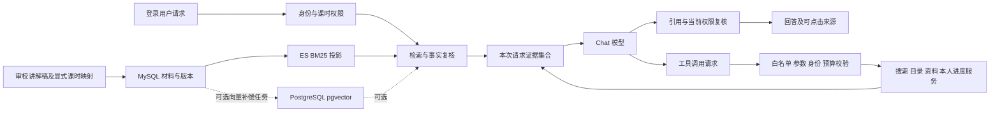

# LearnHub：简历能力对应实现方案

编写日期：2026-10-16。本文是待执行方案，不代表真实模型、Agent 或向量检索已经实现。本轮仅检查代码、核验技术资料和编写方案，不安装服务、不导入材料、不调用模型。

## 1. 目标、现状与完成标准

目标是让简历描述能对应到可演示的业务行为、代码和实际验收记录。采用现有 JDK 17、Spring Boot 3.3.5 模块化单体，不拆微服务，不为接入 AI 直接升级 Boot。

| 简历能力 | 当前代码状态 | 后续交付 |
| --- | --- | --- |
| Redis/Lua + RabbitMQ 优惠券秒杀 | 已有原子预扣、持久化确认、Redisson 临界区锁、幂等、重试、补偿和对账入口 | 保留已有实现，复跑真实中间件用例并记录结果；没有压测数据时不写吞吐数字 |
| ES 多字段检索、标签、热度、前缀联想 | 已有原生 DSL、BM25、function_score 热度上限、completion、同步与重建 | 回归课程卡片搜索，保持它与课程知识块检索分离 |
| RS256 双令牌认证 | 已有刷新令牌原子轮换、访问令牌撤销和 tokenVersion；生产 profile 要求配置密钥 | 复用认证；验证学习助理退出、退款、跨用户与会话权限边界 |
| 课程 RAG 问答 | 已有材料导入、切块、版本、ES BM25、授权检索及来源返回；模型只有 DISABLED/FAKE | 真实模型适配、证据上下文、结构化回答、引用校验、证据不足拒答和页面 |
| 学习助理 Agent | 未实现；现有搜索、资料检索、本人学习进度服务可复用 | Tool Calling 协议、只读工具、受控循环、预算、执行轨迹及真实验收 |
| 向量/混合检索 | 未实现，当前简历也未声称具备 | 作为可选增强，比较 PostgreSQL + pgvector 与已有 BM25，验收后再加入简历 |

前三项的状态以当前代码为依据，旧的 `RESUME_FEATURE_IMPLEMENTATION_HANDOFF.md` 含历史缺口，不能直接当成当前状态。本轮没有重新执行它们的业务测试。AI 已完成部分及此前验收见 [知识检索记录](ASSISTANT_KNOWLEDGE_20261015.md)。

建议演示三个场景：

1. 问“这节 Redis 课为什么使用 Lua？”，回答附当前有权读取的课时来源。
2. 问材料未覆盖的内容，明确说明资料不足；未购买用户不能通过问答读取付费正文。
3. 问“结合我这门课的进度，建议下一步学什么？”，展示查询本人进度、目录和材料的简短执行步骤，再给建议。

## 2. 中间件与技术路线

### 2.1 必需与可选组件

| 组件 | 当前情况 | 本方案用途 | 何时安装或配置 |
| --- | --- | --- | --- |
| MySQL 8.4 | compose 已有；知识表已迁移 | 课程、用户、材料、版本和任务事实源 | 继续使用，不迁移业务库到 PostgreSQL |
| Elasticsearch 8.15.3 + IK | 已有课程索引与独立知识索引 | 课程搜索和第一版知识 BM25 | 继续使用，第一版 RAG 无需额外数据库 |
| Redis | compose 已有 | 现有认证；后续助理限流、并发许可与短期配额预留 | Agent 阶段新增独立键前缀，不复用认证或秒杀键 |
| RabbitMQ / Redisson | 已有 | 维持秒杀等原功能 | RAG 同步请求不经 RabbitMQ；现阶段知识索引仍用补偿任务 |
| 阿里云 OSS | 已有适配 | 保存课程资源 | 知识库先使用现有讲解稿，不把签名媒体 URL 发给模型 |
| Chat 模型服务 | 尚未确定供应商及模型 | 回答生成与 Tool Calling | 阶段 B 前确定一个可访问的供应商、模型、凭据和调用预算；它是外部服务配置，不必装进 Docker |
| Embedding 模型服务 | 未接入 | 文档和问题向量化 | 仅阶段 G 需要；与 Chat 模型分开配置和计费 |
| PostgreSQL + pgvector | 未安装 | 可选的向量检索投影 | 阶段 G 才新增一个容器；pgvector 是 PostgreSQL 扩展，只有普通 PostgreSQL 镜像不等于装好了向量能力 |
| Kibana | compose 已有 | 观察 ES 映射和检索 | 辅助调试，不是 RAG 或 Agent 的运行依赖 |

主线选择：**先完成 BM25 RAG，再做只读 Agent；最后按学习价值加入 pgvector。** RAG 不要求必须使用向量数据库，Tool Calling 也不依赖 MCP。MCP、自动转写、OCR、长期聊天记忆和多 Agent 不属于本次简历能力的前置条件。

向量增强优先采用 PostgreSQL + pgvector 作为学习分支，理由是可直接练习向量距离、SQL 过滤和近邻索引。已有 ES 也能提供 dense_vector/kNN，因此不再同时引入 Milvus、Qdrant 或 Redis 向量索引。两条向量存储路线只实施一条；先保留 BM25 基线便于比较。

### 2.2 PostgreSQL + pgvector 安装草案（阶段 G 才执行）

2026-10-16 核验的官方镜像 tag 可采用 `pgvector/pgvector:0.8.7-pg17-bookworm`；实施时再确认镜像可拉取并记录 digest，不使用漂移的 latest。该镜像提供 PostgreSQL 与扩展文件，仍须在目标数据库执行 `CREATE EXTENSION`。[pgvector 官方 Docker 说明](https://github.com/pgvector/pgvector#docker)

以下是**待合入 compose 的草案**，本轮没有修改 compose 或安装 PG：

```yaml
services:
  pgvector:
    image: pgvector/pgvector:0.8.7-pg17-bookworm
    profiles: ["vector"]
    restart: unless-stopped
    environment:
      POSTGRES_DB: learnhub_vector
      POSTGRES_USER: learnhub_vector_owner
      POSTGRES_PASSWORD: ${LEARNHUB_VECTOR_BOOTSTRAP_PASSWORD:?需配置本地初始化凭据}
    ports:
      - "127.0.0.1:${LEARNHUB_VECTOR_PORT:-15432}:5432"
    volumes:
      - pgvector-data:/var/lib/postgresql/data
    healthcheck:
      test: ["CMD-SHELL", "pg_isready -U $$POSTGRES_USER -d $$POSTGRES_DB"]
      interval: 10s
      timeout: 5s
      retries: 10
volumes:
  pgvector-data:
```

先在 `.env.example` 增加无真实值的示例，再在本地 `.env` 配置凭据；增加 `LEARNHUB_VECTOR_ENABLED`、PG URL/运行账号/密码、Embedding endpoint/model/key/dimensions。初始化账号只用于扩展和迁移，应用另建权限受限的 `learnhub_vector_app`，不使用初始化超级用户。PG SQL 放 `sql/postgres/`，不能把 PG 语句交给 MySQL 的 schema 初始化。

计划从仓库根目录执行：

```powershell
docker compose --env-file .env -f deploy/docker-compose.yml --profile vector up -d pgvector
# 由安装脚本安全注入初始化凭据，在 learnhub_vector 中执行以下 SQL。
```

```sql
CREATE EXTENSION IF NOT EXISTS vector;
SELECT extversion FROM pg_extension WHERE extname = 'vector';
```

安装验收须同时证明容器健康、扩展版本正确、应用账号可以执行受限查询、真实向量写入/检索/重建通过；只看到 15432 端口开启不算完成。无需同时在 Windows 宿主机安装 PostgreSQL。

### 2.3 整体数据流



## 3. 分阶段实施

### A：核验材料，建立可用演示基线

**输入：** `scripts/course-media/catalog.json`、本机数据库课程和课时、已有 20 条待执行评测规格。

1. 选 Redis、Java 等 2～3 门课。只读查询真实课程/课时，按课程 slug、标题和课时归属核验映射；不能用数组位置推断 ID。
2. 审校场景讲解稿；使用已有 `prepare-documents.mjs` 生成请求，调用管理员导入服务。材料继续遵守关联课时权限，不默认公开。
3. 等待索引补偿完成，记录文档数、块数、版本、来源及检索样例。重复执行导入验证幂等。
4. 修订现有评测的来源映射及预期内容。现有 20 条全部标为留出规格：先保留不用于调参，另建小型开发集；不得看完留出结果后反复调阈值还宣称是独立评测。

**产物与验收：** 经核验的映射、受控材料和至少一条真实 BM25 来源返回；付费未购、已购、下架已购、退款、删除课时均符合现有规则。没有真实模型时仍只称“知识检索”。

### B：真实模型接入，先验证一次可控调用

现有 `ChatModelClient.generate(String)` 不能表达工具请求与 usage；应在本阶段调整为少量结构化契约，避免后面再平行造一套客户端：

- `ChatRequest`：消息列表、可选工具定义、输出 Token 上限。
- `ChatResponse`：文本、工具调用列表、usage、结束原因、真实/模拟模式。
- `ChatMessage` / `ToolCall`：保留角色、调用 ID、工具名及参数 JSON，适配后续工具结果消息。

先实现一个固定供应商的 HTTP 适配器，复用 Spring Web 和 Jackson；Fake 与 Disabled 同时适配新契约。供应商决定前不选定 endpoint、模型名称或假设“兼容接口”拥有相同的工具与 usage 行为。

必须覆盖：凭据缺失、401/429、超时、畸形响应、输出被截断、usage 缺失、未知结束原因。默认不自动重试可能已计费的生成请求，尤其不在超时后重复发送；请求超时须取消底层 HTTP 调用。

**产物与验收：** 一个真实适配器、一组本地 HTTP 契约测试及一次明确标记的真实调用记录。真实调用须在供应商、模型和预算确定后执行，密钥只进本地配置。此阶段还不能称为 RAG。

### C：带引用的单轮课程 RAG

拟新增 `POST /api/assistant/course-qa`，要求登录，请求仅含 `courseId、question`。先做非流式、单轮；不持久化聊天正文。

开放这个真实接口前，须先落地 F 中的输入/输出上限、超时、Redis 限流/并发许可和本轮预算预检；F 的标题位置不代表这些保护可以最后才实施。检索阶段已有的权限二次复核也不等于模型生成后的撤权处理已完成。

执行顺序：

1. 复用授权检索，召回候选并通过 MySQL 复核当前材料版本及课时范围。
2. 按证据数量与模型输入预算裁剪，初始最多 5 个有效片段；不能把“每块 600 字”当成 600 Token。
3. 给证据分配本次请求内的 `E1、E2…`，登记到服务端证据集合；上下文带标题、课时及版本，不带媒体签名或用户隐私字段。
4. 无授权证据时直接返回资料不足，不调用模型。弱命中时按开发集校准规则判断是否拒答；不同查询的原始 BM25 分数不能套一个未经评测的万能阈值。
5. 模型按结构化格式返回回答片段、引用证据 ID 及证据不足标记。材料内的任何指令都作为待引用数据，不改变系统约束。
6. 校验结构、长度、引用是否属于本次授权集合、正文事实段是否有引用。真实 API 支持结构化输出时使用其能力，服务端仍做校验；不支持时解析验证失败即返回明确错误。
7. 返回前再次批量复核课程/课时权限和材料版本。模型执行期间发生退款、删除、更新时，若所用证据失效，废弃整份依赖它生成的回答；不能只隐藏链接后仍返回正文。

拟返回 `requestId、answerSegments、citations、insufficientEvidence、modelMode、retrievalMode`。引用由服务器展开为 documentId/sourceVersion/chunkId/courseId/lessonId/title/heading/短摘录，不采用模型自行生成的 URL。所有长 ID 使用字符串。

资料不足属于正常业务结果；检索不可用、模型超时、无效模型输出分别使用可识别错误，不伪装成资料不足。沿用 `ApiResponse`，增加局部错误映射，不借此更改全站错误语义。

**验收：** 能基于授权材料回答、无资料时拒答、伪造引用被拒绝、撤权后不返回已生成的私有回答。引用合法只能证明出处存在，回答是否受证据支持还须人工核对；不承诺“零幻觉”。

### D：课程页面入口与引用展示

在 `LessonView.vue` / `CourseDetailView.vue` 增加“问课程”入口，沿用现有 Vue/TypeScript 和样式。先展示问题、回答、来源、资料不足、错误与加载状态。

来源跳转复用现有 `/courses/:courseId/lessons/:lessonId` 路由；仅定位到课时和场景，不伪造视频秒数。对模型文字使用安全文本或受限制 Markdown，禁止原始 HTML 和模型任意外链。Fake 模式醒目标注“模拟”。

**验收：** 登录过期、资料不足、模型故障、重复提交、长回答和引用跳转都有清楚表现；移动端可用，前端类型检查/构建及已有回归通过。达到 B～D 的真实验收后才可在简历写“课程 RAG 问答”。

### E：只读工具与受控 Agent

先实现工具执行器，再接模型选择；业务工具与 HTTP Controller 分离，复用现有服务层。

明确新增轻量 `CourseOutlineService` 或等价课程服务方法，当前没有可直接复用的无媒体目录工具。第一版 Agent 请求为 `courseId、goal`，材料和进度查询固定在该课程范围；公开课程搜索可返回其他课程卡片，不能据此扩大私有资料范围。E 对外可用前须完成循环次数、deadline、Token 及并发预算保护。

| 工具 | 参数 | 服务端约束 |
| --- | --- | --- |
| `search_courses` | keyword、受限 limit | 公开课程搜索，精简卡片，不返回管理员字段 |
| `get_course_outline` | courseId | 校验调用者课程访问范围，轻量查询目录，移除媒体链接；不直接用会生成媒体签名的 detail 方法 |
| `search_course_materials` | courseId、query、受限 limit | 调用同一授权检索服务，把有效片段登记为本次证据 |
| `get_my_learning_progress` | courseId | 身份只取自调用上下文；通过 LearningProgressService 查询本人数据，过滤已删除/无效课时 |

工具 Schema 不包含 `userId、role、SQL、URL、command`。参数经 JSON Schema/DTO 校验和业务授权后执行；模型建议的其他课程仍须逐课程核验。模型不能自行放宽请求允许的课程范围，也不能更换调用者身份。

循环由程序控制：模型返回最终回答或工具请求 → 解析并校验 → 顺序执行允许的工具 → 按 call ID 回传结构化工具结果 → 再次请求模型。第一版不并行执行工具；即使供应商意外返回多个调用，也逐个校验并计入同一总预算。

建议初始上限为：最多 3 轮工具决策、4 次工具执行、4 次模型调用、45 秒总耗时。每次请求和工具使用剩余 deadline；工具失败只返回有限、脱敏的错误观察。无效工具、错误参数、重复相同调用且无新结果、拒绝执行或触达上限都有终止分支，不能继续无限循环。

最终输出仍经过 C 阶段的来源与权限校验。知识事实引用材料证据；目录和进度引用服务端登记的结构化快照，建议与事实区分展示。没有进度时明确说明；不能编造已学内容，更不能修改 completed 或代替用户完成学习。

每轮发送模型前还要复核累积证据、调用者状态及令牌有效性；工具执行时也检查当前权限。若中途退款、撤权、材料变更或退出使历史工具结果失效，则终止本次运行并丢弃依赖它的回答，不能把旧工具消息继续无条件发给模型。上下文管理不能仅做最终页面隐藏。

**验收：** 模型确实根据问题选择不同工具顺序，能够组合本人进度、目录和资料完成建议；未知工具、伪造身份、重复循环及工具故障全部受控。固定代码依次调用三个服务只能称 workflow，不能作为模型自主选择工具的验收证据。

### F：Token、并发与成本边界，完成简历验收

F 的必要保护应随 B/C/E 逐步加入，不是让早期真实接口裸奔后再补。以配置提供初始值，例如问题 500 字符、RAG 最多 5 片段、每用户 1 个进行中请求、实例最多 4 个模型请求；多实例需要的全局限额使用 Redis 原子许可/租约。Redis 限流不可用时不开放无限调用。

Token 预算必须使用选定模型的实际 tokenizer 或供应商计数能力；输入计数包含系统消息、工具定义、历史工具结果。调用前预留本轮输入 + 最大输出额度，每次调用重复发送的上下文重复计入。初始可设每次 Agent 运行累计 24000 Token，实际根据模型与开发集调整。

usage 返回后记实际消耗；超时或 usage 缺失保留预留额度，不能当成免费调用。所选供应商如果无法可靠计数或限制推理/输出 Token，应明确降级为“估算预算 + 输出/调用次数上限”，在补齐能力前不在简历声称严格 Token 预算。价格、每日费用阈值待具体模型确定后配置，不预先编造金额。

先记录 requestId、用户脱敏标识、模型与提示词版本、检索模式、证据 ID、工具调用计数、usage/预留量、耗时及结束原因。运行记录可写 MySQL `assistant_run`；不为统计而持久化完整问题、答案、私有讲稿或隐藏思维链。频率及配额键按用户隔离，释放许可放 finally，租约防进程异常遗留。

页面仅展示“查询目录→查询本人进度→检索材料”等事实步骤，不展示模型隐藏推理。预算耗尽、429、客户端取消、超时和失败都可观察；取消须传播至底层 HTTP/查询，不能仅停止页面等待。

**最终验收：** 20 条留出规格中已经核验并执行的数量、未执行数量分别报告；对可回答题检查来源命中和回答支持度，对权限题同时断言“响应未泄漏”和“发送给模型的上下文未泄漏”。另有独立工具异常/预算测试。先记录实际延迟、Token 和调用成本，不在没有数据时设定准确率或吞吐承诺。

### G：可选 PostgreSQL + pgvector 混合检索

这一步用于扩展检索能力，不阻塞上述简历功能。安装一个带 pgvector 扩展的 PostgreSQL 容器，并接一个实际 Embedding 服务。先验证精确向量检索，再根据材料规模与实测建立 HNSW；不要小数据阶段就堆索引参数。

数据与一致性设计：

1. MySQL 材料和版本仍是事实源；PG 仅保存可重建的向量投影，不迁移订单、用户或课程表，不把私有原文重复存入 PG。
2. PG 的向量表保存 chunkId、documentId、sourceVersion、courseId、lessonId、chunkHash、embeddingProfile、向量和创建/更新时间；字段使用 PostgreSQL `COMMENT ON` 注释。向量维度必须等真实 Embedding 模型确定后固定，示意维度不能直接部署。
3. `embeddingProfile` 记录供应商、模型、维度和版本。文档与问题用兼容配置；切换模型或维度时新建对应投影并重建，不混用旧向量。
4. 新增独立 MySQL 向量补偿任务，按材料版本幂等写 PG，并以版本条件完成任务；不把 MySQL 和 PG 放进一个伪分布式事务。失败重试、更新、删除和重建均有单独状态。
5. 现有 `currentChunks` 同时要求 ES indexed_version，不能直接成为向量召回的唯一“就绪”判断。抽出“当前事实版本/权限复核”，各检索分支独立验证自己的投影版本；向量正常而 ES 迟延时不误删全部向量结果。
6. 查询先计算允许的课程/课时范围，向量 SQL 加参数化范围过滤；候选返回后统一回 MySQL 复核，不依赖 PG 中可能过期的权限快照。
7. BM25 与向量各取受限候选集，例如各 20 条，按同一片段及版本去重，用应用层 RRF 合并排名，再做权限/版本复核与证据裁剪；不直接把 BM25 分数和余弦相似度相加。
8. ANN 过滤可能不足 Top-K，采用受限提高扫描预算、迭代扫描或小范围精确检索补足；不通过去掉权限过滤补结果。PG 故障时显式返回 `BM25_FALLBACK`，不能伪称混合检索成功。

pgvector 在不建近邻索引时可做精确检索；HNSW 的 vector 索引支持最多 2000 维，halfvec 最多 4000 维。1536/3072 等只是容量示例，不是已经选定的模型输出维度。带过滤的 ANN 可能少于 LIMIT；启用 iterative scan 也仍有扫描预算边界。[官方索引与过滤说明](https://github.com/pgvector/pgvector#hnsw)、[迭代扫描](https://github.com/pgvector/pgvector#iterative-index-scans)

如改用现有 ES 做向量分支，权限应放入 `knn.filter`，不能只在外层 post-filter 后裁剪。应用层 RRF 是本方案的明确选择，避免依赖未核实的集群原生 RRF 许可证；需要原生能力时先检查本机 `_license` 与实际版本授权，不用当前订阅矩阵倒推旧版本授权。[ES 8.15 kNN](https://www.elastic.co/guide/en/elasticsearch/reference/8.15/knn-search.html)、[RRF](https://www.elastic.co/guide/en/elasticsearch/reference/8.15/rrf.html)

后端采用单独命名的 PG 数据源、JdbcTemplate 和事务管理边界。注册第二个 DataSource 可能使 Boot 的默认 MySQL 自动配置退让：必须明确保留/配置 MySQL 为 primary、绑定现有 Mapper 和默认事务管理器，PG 调用显式 qualifier。新增 PostgreSQL JDBC 驱动属于本阶段明确选定的依赖；开启/关闭向量配置两种模式都要做启动和交易回归。[Spring 多事务管理器](https://docs.spring.io/spring-framework/reference/data-access/transaction/declarative/annotations.html#tx-multiple-tx-mgrs-with-attransactional)、[pgJDBC](https://jdbc.postgresql.org/download/)

**验收：** 同一留出集对比 BM25、精确向量和混合召回的来源命中、答案支持度、延迟与成本；记录 ANN 相对精确检索的损失。验证版本更新、权限撤销、PG 中断与补偿重建。只有测得收益后才切换默认检索策略。

## 4. 目录、接口与提交拆分

按职责渐进增加 `assistant/model`、`assistant/qa`、`assistant/tool`、`assistant/agent`，向量阶段才增加 `assistant/vector`；现有 `assistant/knowledge` 继续承载材料事实与检索。不先生成几十个空类或通用 Agent 平台。

拟新增接口：`POST /api/assistant/course-qa`、`POST /api/assistant/agent`；已有管理员导入和 `/api/assistant/retrieve` 保留用于诊断。前两者均要求登录，不接受 userId。第一版无长期会话 ID，无写业务工具。

推荐提交顺序：材料映射/评测夹具 → 模型契约/Fake/HTTP 契约测试 → 一个真实适配器 → RAG 与引用校验 → 页面 → 工具执行器 → Agent 循环 → 配额与运行记录/真实验收。各阶段所需保护同步落地；PG compose/迁移/投影/融合及对照评测独立成后续分支。

后端阶段执行针对测试、`mvn test`、`mvn verify`；前端变更执行相关回归、类型检查和构建；中间件测试使用自有随机库/索引及容器。真实模型与真实 Embedding 用例显式 opt-in，统计实际执行数，默认跳过不算验收。临时后端记录 PID、时间与端口并清理，不擅自重启用户已有服务。

## 5. 实施前需要固定的输入

- 课程与课时映射及审校材料：阶段 A 负责从本地事实核验并落地，不要求用户手工猜 ID。
- 一个 Chat 供应商/模型及真实凭据、可接受调用预算：B 阶段真实调用的前置条件；无凭据仍可完成协议、Fake、HTTP Mock 和 RAG/工具编排测试。
- 供应商真实支持的结构化输出、工具调用、usage、Token 计数/限制与取消行为：按选定 API 官方文档确认并写契约测试，不只看“兼容”宣传。
- 如选择 G，再固定 Embedding 模型、维度、费用和 PG 镜像版本；这不阻塞 A～F。

完成 B～D 的真实验收后，可写“课程 RAG 问答”；完成 E～F 的真实验收后，可写“学习助理 Agent”。在此之前沿用当前“课程知识检索”表述。MCP 不在本次简历中，不为补简历强行增加服务。
